# Informe Técnico Final (versión preliminar) — Centinela Orinoco

> **Nota de versión.** Borrador elaborado el 15/10/2026 a partir de [Specs_Informe_Tecnico_Final.md](./Specs_Informe_Tecnico_Final.md) y del estado del repositorio en el commit `c8ef4f6` (rama `main`). Actualizado el 25/10/2026 con la ingesta satelital e hidrológica real del commit `9c0917e` y siguientes (hasta `ac8920c`): el scheduler ya no genera datos sintéticos. Actualizado el 26/10/2026 con la memoria semántica vectorial (PR #3): embeddings de Gemini en pgvector, búsqueda vectorial espacial, reranker y pruebas automatizadas. Las marcas **[Implementado]**, **[Simulado]** y **[Diseño]** siguen la convención del §5 de las specs. Los textos entre corchetes con la etiqueta `PENDIENTE` deben completarse antes de maquetar el PDF. Las referencias bibliográficas se verificaron contra Crossref o DataCite el 15/10/2026 (ver §R).

---

## P1. Portada

República Bolivariana de Venezuela
Universidad Nacional Experimental de Guayana
Vicerrectorado Académico
Coordinación General de Investigación y Postgrado
Maestría en Tecnologías de la Información
Puerto Ordaz · Cohorte IX

*(Logo: `public/logo-uneg.png`)*

**Seminario I: Arquitectura de Datos Inteligentes**
Trimestre III, 2026

# CENTINELA ORINOCO

## Arquitectura de Datos Inteligentes para la Detección Temprana y el Monitoreo de la Minería Ilegal en el Arco Minero del Orinoco

**Profesora:** PhD. Livia Carolina Borjas Medina

| Integrante | CI | Correo electrónico |
|---|---|---|
| Julio Cesar Canelón Rangel | `PENDIENTE` | `PENDIENTE` |
| José Francisco Escalante Rosales | `PENDIENTE` | `PENDIENTE` |
| Miguel Damián Mota Garrido | `PENDIENTE` | `PENDIENTE` |

**Repositorio:** `PENDIENTE: URL de GitHub/GitLab · rama · commit de entrega`
**Fecha de entrega:** `PENDIENTE`

---

## P2. Resumen ejecutivo

La minería aurífera no regulada en el Arco Minero del Orinoco y en el estado Amazonas provoca deforestación, sedimentación de ríos y contaminación por mercurio que afecta a pueblos indígenas y al embalse de Guri. El problema central es una asimetría de información: las autoridades no cuentan con una infraestructura que integre en tiempo casi real datos satelitales, reportes de campo, denuncias comunitarias y conocimiento científico.

Este trabajo diseña y prototipa Centinela Orinoco, una arquitectura de datos inteligente organizada en cuatro capas. La capa de ingesta recibe anomalías térmicas, radar, imágenes multiespectrales, telemetría hidrométrica y formularios de patrullaje. La capa de almacenamiento combina una base relacional con extensiones espaciales y vectoriales, una base documental para evidencias y un almacén de objetos, coordinados mediante una saga compensable con idempotencia. La capa de inteligencia incorpora una memoria semántica georreferenciada y una cascada de modelos de lenguaje con respaldo determinístico. La capa de consumo ofrece un tablero web con mapa táctico, gestión de incidentes, boletines y un canal de denuncia anónima. El diseño incluye un nodo de borde con almacenamiento local y comunicación por protocolos livianos para operar con cortes de red y de energía.

El prototipo implementa la persistencia políglota, la ingesta real de cinco fuentes satelitales e hidrológicas, la memoria semántica vectorial con búsqueda espacial y el canal comunitario. El análisis de píxeles satelitales y la contenedorización quedan como trabajo inmediato. La propuesta permite que la Guardería Ambiental, los científicos y las comunidades transformen datos dispersos en alertas priorizadas y verificables.

**Palabras clave:** arquitectura de datos inteligente; generación aumentada por recuperación; minería ilegal; Arco Minero del Orinoco; AmazonIA 4.0.

---

## P3. Índices y acrónimos

*Los índices general, de figuras y de tablas se generan al maquetar el PDF.*

| Acrónimo | Significado |
|---|---|
| ABRAE | Áreas Bajo Régimen de Administración Especial |
| ACID | Atomicidad, Consistencia, Aislamiento, Durabilidad |
| AMO | Arco Minero del Orinoco |
| API | Interfaz de programación de aplicaciones |
| BASE | *Basically Available, Soft state, Eventual consistency* |
| C4 | Modelo de diagramas *Context, Containers, Components, Code* |
| CAP | Consistencia, Disponibilidad, Tolerancia a particiones |
| CARE | *Collective benefit, Authority to control, Responsibility, Ethics* |
| DAG | Grafo acíclico dirigido |
| FIRMS | *Fire Information for Resource Management System* (NASA) |
| HNSW | *Hierarchical Navigable Small World* |
| LLM | Modelo de lenguaje de gran escala |
| MQTT | *Message Queuing Telemetry Transport* |
| MSI | *MultiSpectral Instrument* (Sentinel-2) |
| NDVI | Índice de vegetación de diferencia normalizada |
| NTU | Unidades nefelométricas de turbidez |
| RAG | *Retrieval-Augmented Generation* (generación aumentada por recuperación) |
| RBAC | Control de acceso basado en roles |
| RLS | *Row Level Security* |
| SAR | Radar de apertura sintética |
| SPA | Aplicación de página única |
| VIIRS | *Visible Infrared Imaging Radiometer Suite* |

---

# CAPÍTULO I. Diagnóstico territorial y planteamiento del problema

## I.1 Contextualización territorial

El área de estudio se centra en el **estado Bolívar**, donde el Decreto de creación de la Zona de Desarrollo Estratégico Nacional Arco Minero del Orinoco (2016) delimitó cerca de 111.800 km² al sur del río Orinoco para la actividad minera `PENDIENTE: citar Gaceta Oficial N.º 40.855 y verificar cifra`. El AMO se superpone con la cuenca del río Caroní, que alimenta el embalse de Guri, y con las cuencas del Caura y del Cuyuní, además del distrito aurífero de El Callao. Colmenares (2024) documenta, desde la historia ambiental, cómo la implementación del AMO entre 2016 y 2023 aumentó la vulnerabilidad del territorio venezolano.

El análisis se extiende al **estado Amazonas**, en particular al Parque Nacional Yapacana y a los ejes Atabapo y Ventuari, donde la minería ilegal opera dentro de áreas protegidas. Ambos estados albergan territorios de los pueblos **Pemón, Ye'kwana, Sanemá, Piaroa (Uwottüja) y Curripaco**, y áreas protegidas como el Parque Nacional Canaima, cuyos conflictos por extractivismo analizan Rodríguez y Aguilar (2023).

**Figura F1. Zona de estudio.** `PENDIENTE: exportar mapa desde la aplicación (TacticalMap.tsx con public/venezuela_estados.geojson, public/data/ven_strategic_sectors.json y public/data/orinoco_rivers.json), con escala, norte, leyenda de áreas protegidas y territorios indígenas, y fuente.`

## I.2 Situación problemática

El problema central es la **asimetría de información**: no existe una infraestructura que integre en tiempo casi real datos satelitales, de campo y científicos para detectar la minería ilegal a tiempo y orientar la interdicción.

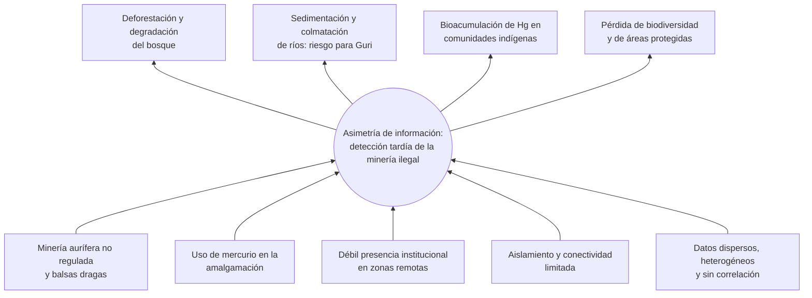
*Figura F2. Árbol de problemas. Elaboración propia.*

Las causas y efectos tienen respaldo en la literatura de la cuenca amazónica:

- **Deforestación asociada a la minería.** Sonter et al. (2017) muestran que la deforestación inducida por la minería en la Amazonía brasileña se extiende hasta 70 km más allá de los límites de las concesiones. Siqueira-Gay y Sánchez (2021) documentan que el auge de la minería ilegal de oro impulsa la deforestación, con especial impacto en tierras indígenas y áreas protegidas. Asner y Tupayachi (2017) y Caballero Espejo et al. (2018) cuantifican la pérdida acelerada de bosques protegidos por minería en Madre de Dios (Perú).
- **Mercurio.** Gerson et al. (2022) demuestran que los bosques cercanos a la minería artesanal de oro capturan niveles elevados de mercurio atmosférico. En Venezuela, García-Sánchez et al. (2006) midieron emisiones atmosféricas de mercurio en áreas mineras contaminadas (obra anterior a 2021 que se cita como antecedente seminal nacional).
- **Sedimentación.** Lobo et al. (2015) evidencian con series temporales Landsat el aumento de sedimentos en aguas amazónicas afectadas por la minería de oro, mecanismo análogo al riesgo de colmatación del Caroní.
- **Contexto venezolano.** Colmenares (2024) y Rodríguez y Aguilar (2023) describen la vulnerabilidad territorial y los conflictos en el sur del país. `PENDIENTE: agregar al menos una fuente indexada sobre Hg en población indígena de Bolívar/Amazonas y una sobre sedimentación del Caroní; complementar con informes de SOS Orinoco y RAISG como literatura gris declarada.`

## I.3 Datos generados en la zona y limitaciones de los sistemas tradicionales

**Cómo se detecta hoy.** La detección depende de patrullajes fluviales y terrestres de la Guardería Ambiental, de denuncias que llegan por canales informales y de revisiones satelitales puntuales realizadas por organizaciones de la sociedad civil. Cada fuente se consulta por separado, sin un registro común ni correlación espacial, y la decisión de intervenir se toma de forma manual, con días o semanas de retraso respecto a la apertura de un frente minero.

**Tabla T1. Fuentes de datos y dimensiones del Big Data**

| Fuente | Tipo de dato | Formato | Frecuencia | Volumen estimado | V dominante | Estado en el prototipo |
|---|---|---|---|---|---|---|
| NASA FIRMS (VIIRS NOAA-20, VIIRS S-NPP, MODIS NRT) | Anomalías térmicas (brillo K, potencia MW, confianza) | CSV (API de área, últimos 2 días) | 3 h | Decenas a cientos de focos/día en la zona `PENDIENTE: medir en ingestion_runs` | Velocidad | [Implementado] `server/ingestion/firms.ts` → `nasa_firms_hotspots` |
| Sentinel-1 SAR | Catálogo de escenas GRD (modo, polarización, órbita, huella) | STAC (Copernicus Data Space) | 12 h | Metadatos; las escenas (~1 GB GRD) no se descargan | Volumen | [Implementado] catálogo `server/ingestion/stac.ts` → `sentinel1_scenes`; análisis de retrodispersión [Diseño] |
| Sentinel-2 MSI | Catálogo de productos L2A (nubosidad, órbita, huella) | STAC (Copernicus Data Space) | 24 h | Metadatos; las bandas JP2/SAFE no se descargan | Volumen | [Implementado] catálogo → `s2_product_tile`, `/api/s2/tiles`; NDVI y turbidez [Diseño] |
| Sentinel-3 OLCI / SLSTR | Catálogo de productos de agua (OL_2_WFR, SL_2_WST) | OData (Copernicus Data Space) | 24 h | Metadatos (tamaño del producto registrado) | Volumen | [Implementado] `server/ingestion/sentinel3.ts` → `sentinel3_products` |
| Niveles del río Orinoco (INAMEH) | Cota (msnm), variación diaria, tendencia, cota de desborde | Boletines PDF | 6 h | Bajo (4 estaciones) | Veracidad | [Implementado] `server/ingestion/inameh.ts` → `hydrological_telemetry_readings`; turbidez y Hg no se publican |
| KoboToolbox / ODK | Minutas de patrullaje, fotos, GPS | JSON (webhook) + binarios | Por evento | Medio | Variedad | [Implementado] `/api/webhooks/kobo`, `/api/webhooks/odk` |
| Denuncias comunitarias | Texto, imágenes, video, geolocalización | JSON + binarios | Por evento | Medio | Variedad / Veracidad | [Implementado] `/api/community-reports` |
| Corpus científico | PDF, DOI, URL | PDF / texto | Por evento | Bajo | Valor | [Implementado] `/api/corpus/ingest` |

*Fuente: elaboración propia a partir de `server.ts`, `server/satelliteScheduler.ts`, `server/ingestion/`, `supabase/migrations/202610250001_real_satellite_ingestion.sql` y [TECHNICAL_REPORT_INGESTION.md](../TECHNICAL_REPORT_INGESTION.md). Solo se conservan registros cuyo centro cae en Amazonas, Bolívar, Delta Amacuro o Guayana Esequiba.*

**Por qué fallan los sistemas tradicionales:**

1. **Heterogeneidad.** Una base de datos relacional convencional no acomoda a la vez rásteres, series temporales, formularios con fotos y texto libre sin perder información o sin migraciones constantes.
2. **Latencia y cortes de red.** Los sistemas centralizados asumen conectividad continua, que no existe en el sur de Bolívar ni en Amazonas.
3. **Ausencia de correlación multifuente.** Un foco térmico aislado no prueba minería; la evidencia surge al cruzar el foco con la caída de retrodispersión SAR, la turbidez del río y un reporte de campo cercano.
4. **Búsqueda léxica sin semántica.** Una búsqueda por palabras clave no relaciona "balsa draga en el Atabapo" con un artículo sobre "mercurio en sedimentos del Orinoco medio".
5. **Decisiones manuales.** Sin reglas automatizadas, la priorización depende de la disponibilidad del analista.

Estas limitaciones justifican el uso de vectores, RAG y orquestación, que es el criterio de viabilidad tecnológica de la rúbrica.

## I.4 Objetivos

**Objetivo general.** Diseñar una arquitectura de datos inteligente que permita detectar de forma temprana y monitorear la minería ilegal en el Arco Minero del Orinoco.

**Objetivos específicos:**

1. **OE1.** Caracterizar las fuentes de datos satelitales, de campo, comunitarias y científicas disponibles para el sur de Venezuela según las dimensiones del Big Data.
2. **OE2.** Diseñar una arquitectura por capas, de alta disponibilidad y persistencia políglota, con resiliencia ante cortes de red y de energía.
3. **OE3.** Implementar una memoria semántica georreferenciada (RAG espacial) que combine evidencia de campo y corpus científico.
4. **OE4.** Automatizar el flujo de ingesta, correlación y alerta mediante un orquestador con reglas de decisión explícitas.
5. **OE5.** Prototipar la capa de consumo y validar la tolerancia a fallos del sistema con pruebas ante datos corruptos o vacíos.

## I.5 Justificación bajo AmazonIA 4.0 y respaldo UNESCO

La iniciativa **AmazonIA 4.0** (Borjas) propone el desarrollo sostenible de la Amazonía combinando biodiversidad, saber indígena y tecnologías de la Cuarta Revolución Industrial (IA, Big Data, Blockchain e IoT). Centinela Orinoco se inscribe en ella como **capa habilitadora de datos**: sin un registro integrado y confiable de las amenazas, no es posible proteger el capital natural sobre el que se construyen las cadenas de valor que AmazonIA 4.0 promueve.

La **UNESCO**, a través del Programa sobre el Hombre y la Biosfera y su trabajo con las reservas de biosfera amazónicas, promueve la reconciliación entre conservación y desarrollo local apoyada en ciencia y creación de capacidades. `PENDIENTE: citar el documento oficial de la UNESCO con URL verificada.`

- **Pertinencia científica.** Atiende un problema documentado en la literatura indexada (§I.2) y aporta un esquema para correlacionar fuentes que la literatura suele analizar por separado (§II.4).
- **Pertinencia metodológica.** Aplica principios de arquitectura de datos (capas, persistencia políglota, sagas, idempotencia) y de gobernanza de datos indígenas (principios CARE; Carroll et al., 2020).
- **Pertinencia tecnológica.** Usa datos satelitales abiertos, software de código abierto y modelos de lenguaje como apoyo a la decisión, con estrategias de degradación controlada para el entorno del sur de Venezuela.

## I.6 Alcance y limitaciones del prototipo

| Componente | Estado | Evidencia |
|---|---|---|
| Persistencia políglota PostgreSQL + MongoDB + Storage con saga e idempotencia | **[Implementado]** | `server/services/hybridIncidentService.ts`, `supabase/migrations/2026101400*.sql` |
| Canal de denuncias comunitarias con evidencia y elevación a incidente | **[Implementado]** | `server/services/communityReportService.ts`, `/api/community-reports/*` |
| Ingesta de corpus científico (PDF, DOI vía Crossref, geofencing por LLM) | **[Implementado]** | `/api/corpus/ingest` |
| Webhooks Kobo/ODK | **[Implementado]** | `/api/webhooks/kobo`, `/api/webhooks/odk` |
| Scheduler con ingesta real (FIRMS, Sentinel-1/2/3, INAMEH) sin duplicados | **[Implementado]** | `server/satelliteScheduler.ts`, `server/ingestion/*`, tabla `ingestion_runs` |
| Análisis de imagen satelital (retrodispersión, NDVI, turbidez) | **[Diseño]**: se ingiere el catálogo, no los píxeles | — |
| Cascada de 4 modelos LLM con respaldo determinístico | **[Implementado]** | `server/aiModelManager.ts` |
| Búsqueda RAG vectorial espacial (similitud coseno + `ST_DWithin`) con respaldo por texto | **[Implementado]** | `server/ragSearch.ts`, RPC `match_environmental_documents`, `/api/rag/vector-search` |
| Generación y persistencia de embeddings (`gemini-embedding-001`, 768 dimensiones) | **[Implementado]** | `server/embeddings.ts`, `server/embeddingWorker.ts`, `supabase/migrations/202610260001_rag_vector_search.sql` |
| Filtro / reranker de puntaje compuesto | **[Implementado]** | `server/rag/reranker.ts` (Anexo A.1) |
| Kafka, Spark, Delta Lake/MinIO, Airflow | **[Diseño]** | §III.3, III.4, III.6 |
| Nodo edge, MQTT, LoRaWAN | **[Diseño]**; el buffer offline del servidor es **[Implementado]** | §III.8 |
| RBAC con RLS por rol | **[Diseño]**; RLS habilitado y acceso restringido a `service_role` es **[Implementado]** | §III.7 |
| Blockchain | **[Diseño]** / trabajo futuro | §III.7 |
| Pruebas unitarias (26 casos, `npm test`) | **[Implementado]** para la memoria semántica | `tests/` |
| Dockerfile y Docker Compose | **No existen aún** en el repositorio | §III.10 |

---

# CAPÍTULO II. Estado del arte y marco científico

## II.1 Metodología de revisión

- **Bases consultadas:** Crossref (como índice de metadatos y verificación de DOI), Scopus, Web of Science, SciELO y Google Académico. `PENDIENTE: confirmar en Scopus/SciELO la indexación de cada artículo.`
- **Período:** 2021–2026, con excepciones justificadas para obras seminales.
- **Cadenas de búsqueda (ejemplos):**
  - `"illegal gold mining" AND (Sentinel-1 OR SAR OR Sentinel-2) AND Amazon`
  - `mercury AND "gold mining" AND (Venezuela OR Amazon) AND indigenous`
  - `"Arco Minero del Orinoco"`
  - `"retrieval-augmented generation" AND (environmental OR geospatial)`
  - `(LoRaWAN OR MQTT) AND "environmental monitoring"`
- **Criterios de inclusión:** artículo arbitrado o capítulo académico con DOI; tema de minería, deforestación, mercurio o sedimentación en la cuenca amazónica, o técnica aplicable a una capa de la arquitectura.
- **Criterios de exclusión:** sin DOI verificable, sin acceso al resumen, fuera de tema o duplicado.

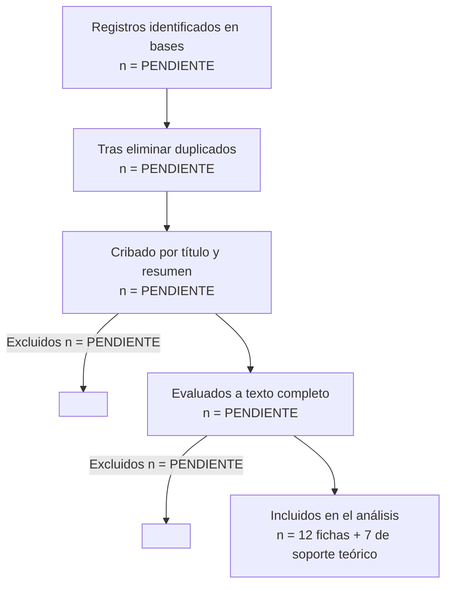
*Figura F3. Flujo de selección bibliográfica (PRISMA simplificado). Elaboración propia. Los conteos deben registrarse durante la búsqueda.*

## II.2 Antecedentes

### Recursos proporcionados por la profesora

#### [Ref. 1] The Impact of Artificial Intelligence on the Sustainability of Regional Ecosystems: Current Challenges and Future Prospects
- Pimenow, Pimenowa, Prus y Niklas · 2025 · *Sustainability*, 17(11), 4795 · https://doi.org/10.3390/su17114795 · Indexación: Scopus, WoS `PENDIENTE: cuartil`
- **Objetivo y método:** revisión sobre despliegues de IA en ecosistemas regionales para el monitoreo de bosques, agua y agricultura.
- **Hallazgos clave:** identifica retos institucionales y socioeconómicos para que la IA aporte sostenibilidad a escala regional. `PENDIENTE: extraer cifras.`
- **Aporte a Centinela Orinoco:** respalda la **capa de inteligencia** y la necesidad de diseñar la gobernanza junto con el modelo.
- **Brecha:** no aborda entornos con conectividad intermitente ni la correlación de fuentes satelitales con reportes comunitarios.

#### [Ref. 2] Are smart technologies enough to build climate-resilient cities? A bibliometric assessment of global trends and research gaps
- de Bruyn, Said, Venter y Castanho · 2026 · *City and Environment Interactions*, 29, 100306 · https://doi.org/10.1016/j.cacint.2026.100306 · Indexación: Scopus `PENDIENTE: confirmar`
- **Nota:** el título registrado difiere ligeramente del citado en el enunciado ("...cities and regions?").
- **Objetivo y método:** evaluación bibliométrica de la integración de Big Data, IoT e IA en la resiliencia climática.
- **Aporte:** respalda la **capa de gobernanza**: la tecnología no basta sin marcos institucionales.
- **Brecha:** enfoque urbano; no trata territorios selváticos ni indígenas.

#### [Ref. 3] Applications of AI to low carbon decision support system for global supply chains
- Vishwakarma, Patro y Acquaye · 2025 · *Cleaner Logistics and Supply Chain*, 17, 100261 · https://doi.org/10.1016/j.clscn.2025.100261 · Indexación: Scopus `PENDIENTE: confirmar`
- **Nota:** el título registrado difiere del citado en el enunciado ("...in global networks").
- **Objetivo y método:** analiza el uso de IA en sistemas de soporte a la decisión para cadenas de suministro bajas en carbono.
- **Aporte:** respalda el **flujo dinámico automatizado**: la analítica predictiva en tiempo casi real previene brechas normativas.
- **Brecha:** orientado a cadenas de suministro; no a la detección de ilícitos ambientales.

#### [Ref. 4] Big Data Analytics in Information Systems Research: Current Landscape and Future Prospects
- Arafat, Akula, Mohammed y Haque · 2025 · *The American Journal of Engineering and Technology*, 7(08), 177–201 · https://doi.org/10.37547/tajet/volume07issue08-16 · Indexación: `PENDIENTE: verificar; posiblemente fuera de Scopus/WoS`
- **Aporte:** marco de las 5V (volumen, velocidad, variedad, veracidad, valor) usado en la Tabla T1 para estructurar la **capa de ingesta**.
- **Brecha:** marco general, sin aplicación ambiental.

#### [Ref. 5] Digital twins for logistics and supply chain systems: Literature review, conceptual framework, research potential, and practical challenges
- Le y Fan · 2024 · *Computers & Industrial Engineering*, 187, 109768 · https://doi.org/10.1016/j.cie.2023.109768 · Indexación: Scopus, WoS
- **Nota:** el enunciado lo cita como "Digital twins for regional and supply chain systems". `PENDIENTE: confirmar con la profesora que se trata de este artículo.`
- **Aporte:** respalda la sincronización de datos de campo (IoT) con un modelo digital en la nube; base del **gemelo digital de la cuenca** propuesto como trabajo futuro.
- **Brecha:** no considera sincronización con enlaces satelitales intermitentes.

### Antecedentes propios del equipo

#### [Ref. 6] Change Detection of Amazonian Alluvial Gold Mining Using Deep Learning and Sentinel-2 Imagery
- Camalan et al. · 2022 · *Remote Sensing*, 14(7), 1746 · https://doi.org/10.3390/rs14071746 · Scopus, WoS
- **Objetivo y método:** detección de cambios por minería aluvial de oro en la Amazonía peruana con redes profundas sobre Sentinel-2.
- **Aporte:** respalda el uso de **Sentinel-2** en la capa de ingesta y la línea futura de modelos entrenados con datos reales.
- **Brecha:** un solo sensor óptico, afectado por la nubosidad; sin integración con reportes de campo.

#### [Ref. 7] Avaliação das imagens SAR/Sentinel-1 para identificação de garimpos de ouro embarcados por meio de algoritmos de detecção de embarcações
- Pereira, Gomes, Carvalho Júnior y Guimarães · 2024 · *Caminhos de Geografia*, 25(98), 150–169 · https://doi.org/10.14393/rcg259869530 · Indexación: `PENDIENTE: verificar (Latindex/DOAJ)`
- **Objetivo y método:** evalúa Sentinel-1 con algoritmos de detección de embarcaciones para identificar dragas de oro flotantes.
- **Aporte:** respalda directamente el uso de **SAR** para detectar balsas dragas en ríos como el Caroní, el Caura y el Atabapo, con independencia de la nubosidad.
- **Brecha:** no incorpora corroboración en campo ni flujo de alerta.

#### [Ref. 8] Tool to Generate Deforestation and Illegal Mining Alerts with Remote Sensing
- Valbuena Gaona, Ferrucho Parra, Prieto Arenas y Muñoz Bravo · 2024 · *Environmental Sciences Proceedings*, 28(1), 27 · https://doi.org/10.3390/environsciproc2023028027 · Indexación: `PENDIENTE: verificar`
- **Aporte:** antecedente de **sistema de alertas** basado en teledetección; sirve de contraste para el flujo dinámico.
- **Brecha:** alertas a partir de una sola familia de datos; sin memoria semántica ni canal comunitario.

#### [Ref. 9] Amazon forests capture high levels of atmospheric mercury pollution from artisanal gold mining
- Gerson et al. · 2022 · *Nature Communications*, 13, 559 · https://doi.org/10.1038/s41467-022-27997-3 · Scopus, WoS (Q1)
- **Hallazgos:** el dosel de los bosques cercanos a la minería artesanal acumula niveles elevados de mercurio atmosférico.
- **Aporte:** justifica incluir **Hg estimado** en la telemetría y como variable del corpus vectorizado.
- **Brecha:** estudio en Perú; faltan datos equivalentes para la Guayana venezolana.

#### [Ref. 10] The outbreak of illegal gold mining in the Brazilian Amazon boosts deforestation
- Siqueira-Gay y Sánchez · 2021 · *Regional Environmental Change*, 21, 28 · https://doi.org/10.1007/s10113-021-01761-7 · Scopus, WoS
- **Aporte:** respalda la **regla de proximidad a áreas protegidas y territorios indígenas** del motor de decisión (§III.6).
- **Brecha:** análisis retrospectivo; no propone detección temprana.

#### [Ref. 11] Deforestation and Forest Degradation Due to Gold Mining in the Peruvian Amazon: A 34-Year Perspective
- Caballero Espejo et al. · 2018 · *Remote Sensing*, 10(12), 1903 · https://doi.org/10.3390/rs10121903 · Scopus, WoS · *Seminal (> 5 años)*
- **Aporte:** serie temporal larga que muestra la dinámica de expansión minera; respalda el **almacenamiento histórico** (zona Gold del Lakehouse).
- **Brecha:** sin integración de fuentes no satelitales.

#### [Ref. 12] El arco minero del Orinoco (AMO) y la vulnerabilidad del territorio venezolano (2016–2023): una mirada desde la historia ambiental
- Colmenares · 2024 · *Procesos Históricos*, (45), 100–123 · https://doi.org/10.53766/prohis/2024.45.06 · Indexación: `PENDIENTE: verificar SciELO/Latindex`
- **Aporte:** contextualiza el **problema específico venezolano** (Cap. I).
- **Brecha:** enfoque histórico, sin propuesta tecnológica.

**Literatura de soporte (contexto y marco teórico):** Sonter et al. (2017); Asner y Tupayachi (2017); Lobo et al. (2015); García-Sánchez et al. (2006); Rodríguez y Aguilar (2023); Lewis et al. (2020); Gao et al. (2023); Malkov y Yashunin (2020); Carroll et al. (2020); Rosli et al. (2020).

> **Observación de cumplimiento.** El corpus suma 12 fichas, cinco de ellas sobre la Amazonía (Refs. 6, 7, 9, 10, 11) y una sobre Venezuela (Ref. 12). La literatura indexada específica de la Amazonía venezolana es escasa; esta escasez se declara como hallazgo de la revisión y refuerza la pertinencia del proyecto.

## II.3 Matriz comparativa

**Tabla T2. Matriz comparativa de antecedentes**

| Ref. | Región | Fuente de datos | Técnica de IA | RAG / semántica | Tiempo casi real | Offline / edge | Gobernanza indígena | Limitación principal |
|---|---|---|---|---|---|---|---|---|
| 1 | Global / regional | Múltiple | IA general (revisión) | No | No | No | Parcial | Sin implementación |
| 2 | Urbana global | Big Data, IoT | Bibliometría | No | No | No | No | Enfoque urbano |
| 3 | Cadenas globales | Operacionales | IA para soporte a decisión | No | Sí | No | No | Otro dominio |
| 4 | General | — | BDA (marco 5V) | No | Parcial | No | No | Marco general |
| 5 | Cadenas de suministro | IoT | Gemelo digital | No | Sí | No | No | Otro dominio |
| 6 | Perú (Amazonía) | Sentinel-2 | Aprendizaje profundo | No | No | No | No | Un sensor, nubes |
| 7 | Brasil (Amazonía) | Sentinel-1 | Detección de objetos SAR | No | No | No | No | Sin corroboración |
| 8 | `PENDIENTE` | Teledetección | Alertas por umbral | No | Parcial | No | No | Una fuente |
| 9 | Perú (Amazonía) | Muestreo de campo | — | No | No | No | No | Sin monitoreo continuo |
| 10 | Brasil (Amazonía) | Datos de deforestación | Estadística espacial | No | No | No | Parcial | Retrospectivo |
| 11 | Perú (Amazonía) | Landsat | Clasificación | No | No | No | No | Una fuente |
| 12 | Venezuela (AMO) | Documental | — | No | No | No | Parcial | Sin tecnología |
| **Centinela Orinoco** | **Venezuela (Bolívar, Amazonas)** | **Satelital + campo + comunidad + corpus** | **LLM, RAG espacial, reglas** | **Sí** | **Sí (diseño)** | **Sí (diseño)** | **Sí** | Prototipo; ingesta satelital real, sin análisis de imagen |

*Fuente: elaboración propia.*

## II.4 Brechas e innovación

**Brechas identificadas:**

1. **Un solo sensor.** Los trabajos detectan minería con un sensor (Refs. 6, 7, 11) y casi ninguno correlaciona satélite, campo y literatura científica.
2. **Sin memoria semántica georreferenciada.** Ningún antecedente combina búsqueda vectorial y filtros espaciales sobre evidencia y corpus científico.
3. **Operación offline.** Ninguno aborda la operación con conectividad intermitente propia del sur de Venezuela.
4. **Gobernanza indígena.** La gobernanza de datos indígenas aparece solo de forma tangencial (Refs. 1, 10, 12).

**Innovación declarada, contrastada con los antecedentes:**

| Innovación | Contraste | Estado |
|---|---|---|
| RAG espacial híbrido: similitud coseno + `ST_DWithin` en una sola consulta | Refs. 6, 7, 11 usan clasificación sin memoria semántica | [Implementado] (Anexos A.1–A.2) |
| Geofencing semántico del corpus: un LLM rechaza documentos ajenos a la Amazonía venezolana (HTTP 400) | Las revisiones (Refs. 1, 4) no filtran por pertinencia territorial | [Implementado] |
| Cascada de 4 modelos LLM con respaldo determinístico | Los sistemas de alerta (Ref. 8) dependen de un solo motor | [Implementado] |
| Persistencia políglota con saga compensable e idempotencia | Ningún antecedente trata la consistencia entre motores | [Implementado] |
| Denuncia comunitaria anónima con elevación a incidente | Ref. 10 reconoce el impacto en tierras indígenas, pero sin canal de participación | [Implementado] |

## II.5 Marco teórico-técnico

- **5V del Big Data.** Volumen, velocidad, variedad, veracidad y valor (Ref. 4) orientan la Tabla T1.
- **Lakehouse.** Arquitectura que combina el almacenamiento económico de un data lake con transacciones ACID y esquemas de un data warehouse, implementable con Delta Lake sobre almacenamiento de objetos compatible con S3, como MinIO. Se organiza en zonas Bronze (crudo), Silver (limpio) y Gold (agregado).
- **Batch vs. streaming.** El lote procesa conjuntos acotados (mosaicos Sentinel-2); el streaming procesa eventos continuos (telemetría, webhooks).
- **Embeddings y bases vectoriales.** Representan texto como vectores densos; la búsqueda de vecinos aproximados con índices HNSW (Malkov y Yashunin, 2020) o IVFFlat permite recuperar por similitud en grandes colecciones.
- **RAG y reranking.** RAG condiciona la generación de un LLM con documentos recuperados (Lewis et al., 2020; Gao et al., 2023). El reranking reordena los candidatos con criterios adicionales antes de la síntesis.
- **Orquestación.** Un DAG define dependencias entre tareas; Apache Airflow es la referencia del curso.
- **Edge computing y protocolos livianos.** El procesamiento en el borde reduce la dependencia del enlace. MQTT ofrece publicación/suscripción con niveles de QoS y LoRaWAN, largo alcance con bajo consumo (Rosli et al., 2020).
- **Persistencia políglota y CAP/ACID/BASE.** Cada dato se guarda en el motor que mejor se ajusta a su forma. Entre motores se acepta una ventana de consistencia eventual.
- **Patrón saga.** Secuencia de transacciones locales con acciones compensatorias que deshacen el efecto lógico si un paso posterior falla.
- **RBAC y anonimización.** Permisos asignados a roles, no a personas; técnicas de supresión y generalización de identificadores y coordenadas.
- **Principios CARE.** Beneficio colectivo, autoridad para controlar, responsabilidad y ética en datos indígenas (Carroll et al., 2020).
- **Gemelo digital.** Réplica digital sincronizada con un sistema físico (Ref. 5).
- **Blockchain.** Registro distribuido inmutable útil para la trazabilidad de evidencias y la certificación de origen.

---

# CAPÍTULO III. Diseño de la arquitectura de datos inteligente

## III.1 Vista general por capas

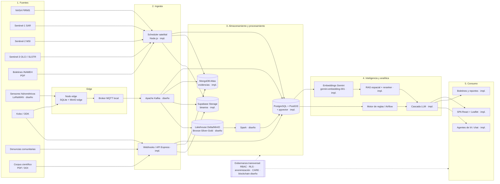
*Figura F4. Diagrama de bloques por capas, de campo a consumo. Elaboración propia.*

## III.2 Diagramas C4

**Nivel 1 — Contexto**

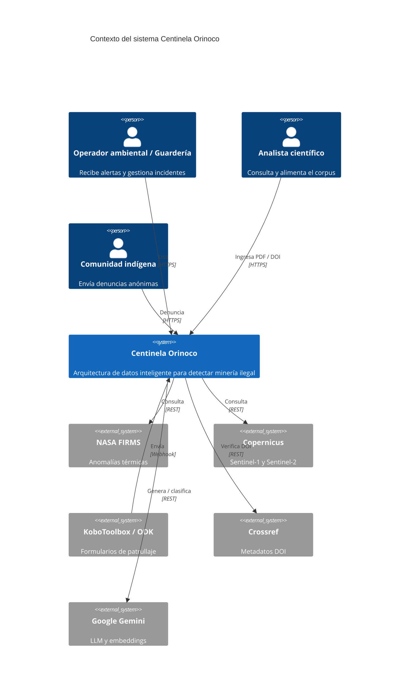
*Figura F5. C4 nivel 1. Elaboración propia.*

**Nivel 2 — Contenedores**

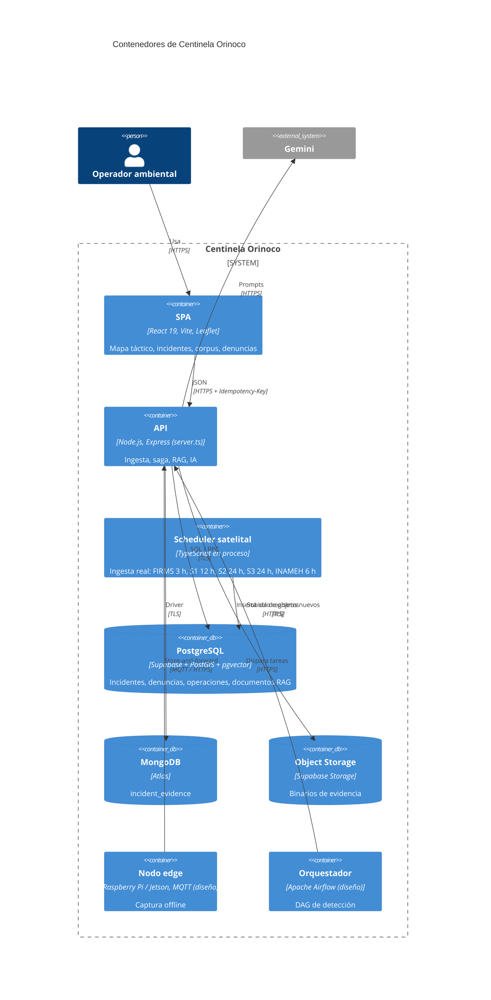
*Figura F6. C4 nivel 2. Elaboración propia.*

**Nivel 3 — Componentes de la API**

| Componente | Archivo | Responsabilidad |
|---|---|---|
| `SatelliteAutomatedScheduler` | `server/satelliteScheduler.ts` | Cinco tareas con cadencia de producción, conectores reales, deduplicación e historial en `ingestion_runs` |
| `AIModelCascadeManager` | `server/aiModelManager.ts` | Cascada de 4 modelos, cuotas, enfriamiento ante 429 |
| `EmbeddingWorker` | `server/embeddingWorker.ts`, `server/embeddings.ts` | Vectorización por lotes de los documentos RAG con Gemini |
| `zoneAnalyticsEngine` | `server/zoneAnalyticsEngine.ts` | Análisis predictivo por zona |
| `communityReportService` | `server/services/communityReportService.ts` | Denuncias, evidencia en Storage, anonimización |
| `hybridIncidentService` | `server/services/hybridIncidentService.ts` | Saga PostgreSQL → MongoDB con compensación |
| Pipeline de corpus | `server.ts` (`/api/corpus/*`) | PDF, Crossref, geofencing LLM, deduplicación |
| RAG | `server/ragSearch.ts`, `server/rag/reranker.ts`, `server.ts` (`/api/rag/vector-search`) | Búsqueda vectorial espacial, reranker, respaldo por texto y síntesis LLM |

*Figura F7. C4 nivel 3 (versión tabular; `PENDIENTE: dibujar en Structurizr/PlantUML y guardar en docs/diagramas/`).*

## III.3 Capa de fuentes e ingesta

**Mecanismos implementados:**

- **Scheduler satelital e hidrológico [Implementado].** `SatelliteAutomatedScheduler` mantiene cinco tareas con cadencia de producción (`server/satelliteScheduler.ts:110-150`). Cada tarea consulta una fuente real mediante su conector en `server/ingestion/`:
  - NASA FIRMS cada 3 h: API de área con VIIRS NOAA-20, VIIRS S-NPP y MODIS NRT. Requiere `FIRMS_MAP_KEY`.
  - Sentinel-1 GRD cada 12 h y Sentinel-2 L2A cada 24 h: búsqueda STAC en Copernicus Data Space sobre los últimos 4 días.
  - Sentinel-3 OLCI/SLSTR cada 24 h: catálogo OData de Copernicus.
  - Niveles del Orinoco cada 6 h: boletines PDF de INAMEH para las estaciones 0850, 0855, 0870 y 0875.

  Cada ejecución inserta solo los registros nuevos (`insertOnlyNew`, con claves de conflicto por fuente) en `nasa_firms_hotspots`, `sentinel1_scenes`, `s2_product_tile`, `sentinel3_products` y `hydrological_telemetry_readings`. Los focos FIRMS relevantes y las lecturas hidrológicas generan además un documento narrativo en `environmental_rag_documents`. Cada ejecución queda registrada en `ingestion_runs` con los registros recibidos, insertados y omitidos. La próxima ejecución se calcula a partir de esa tabla, así que la cadencia se mantiene tras un reinicio. Se descartan los registros fuera de Amazonas, Bolívar, Delta Amacuro y Guayana Esequiba. Para Sentinel se ingiere el catálogo de escenas y productos; las bandas y su análisis (retrodispersión, NDVI, turbidez) siguen en **[Diseño]**.
- **Webhooks Kobo/ODK [Implementado].** `/api/webhooks/kobo` y `/api/webhooks/odk` validan el formato y responden 400 ante cargas inválidas.
- **Telemetría [Implementado].** Las lecturas de INAMEH se consultan con `GET /api/telemetry/stations` y `GET /api/telemetry/readings`. El endpoint de carga manual `/api/telemetry/ingest` se retiró junto con los datos sintéticos.
- **Corpus científico [Implementado].** `/api/corpus/ingest` extrae texto con `pdf-parse`, consulta Crossref por DOI, clasifica con el LLM y rechaza con HTTP 400 los documentos ajenos a la Amazonía venezolana o a la detección de minería.
- **Denuncias comunitarias [Implementado].** `/api/community-reports` valida título, descripción y coordenadas, y sube la evidencia al bucket privado `community-evidence`.

**Diseño objetivo con Apache Kafka [Diseño].** El scheduler en proceso se sustituye por productores independientes que publican en tópicos de Kafka: `firms.raw`, `s1.raw`, `s2.raw`, `telemetry.raw` y `field.reports`. Los consumidores escriben en la zona Bronze del Lakehouse y, en paralelo, en PostgreSQL para la operación. Así se desacoplan la captura y el procesamiento, se permite reprocesar desde el log y se escala por partición.

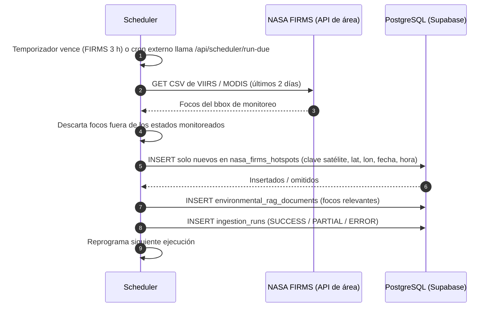

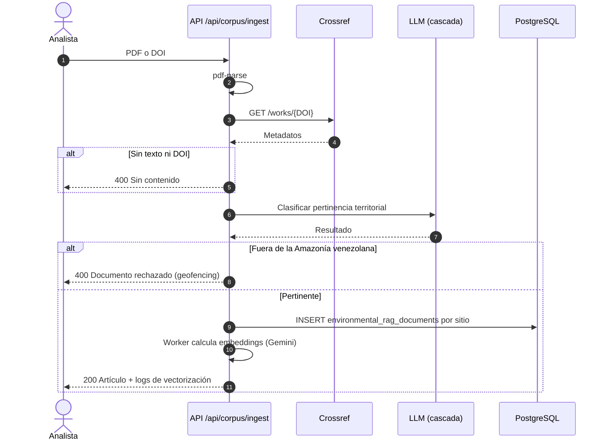
*Figura F8. Secuencias de ingesta satelital y de corpus. Elaboración propia.*

## III.4 Almacenamiento y procesamiento

**Persistencia políglota [Implementado].** El detalle está en [02-arquitectura-y-modelo-de-datos.md](../src/docs/specs/02-arquitectura-y-modelo-de-datos.md) y en [03-api-y-orquestacion-hibrida.md](../src/docs/specs/03-api-y-orquestacion-hibrida.md).

**Tabla T3. Asignación de datos por motor**

| Dato | Motor | Justificación |
|---|---|---|
| Denuncias, incidentes, operaciones de integración | PostgreSQL / Supabase | ACID, restricciones, integridad referencial, unicidad de códigos |
| Geometrías y consultas territoriales | PostGIS | Índices GiST, `ST_DWithin`, columnas `geom` generadas |
| Vectores de documentos RAG | pgvector | Co-localización con PostGIS: filtro espacial y semántico en una sola consulta |
| Evidencia heterogénea, análisis satelital, enriquecimientos de IA | MongoDB (`incident_evidence`) | Documentos anidados, esquema evolutivo con `schema_version` |
| Fotos, videos, PDF | Supabase Storage | Binarios fuera de la base; MongoDB guarda ruta, tipo y `sha256` |
| Crudo histórico, features para ML | Lakehouse Delta/MinIO [Diseño] | Bajo costo, versionado, procesamiento con Spark |

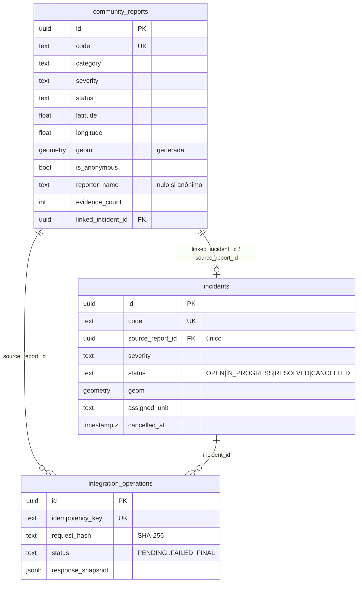
*Figura F9. Modelo relacional (`supabase/migrations/202610140001_hybrid_persistence_base.sql`). Elaboración propia. El documento MongoDB de ejemplo está en la spec 02.*

Restricciones destacables del esquema:

- `community_reports_anonymous_privacy_chk` impide guardar nombre o contacto cuando `is_anonymous` es verdadero.
- `incidents_cancellation_consistency_chk` exige `cancelled_at` solo en estado `CANCELLED`.
- RLS está habilitado en las tres tablas y se revocan los permisos de `anon` y `authenticated`; solo `service_role` (backend) opera.

> **Brecha de esquema.** La tabla `environmental_rag_documents` se usa en `server.ts`, `server/satelliteScheduler.ts` y `server/zoneAnalyticsEngine.ts`. La migración `202610250001_real_satellite_ingestion.sql` le agrega `content_hash` y un índice único para no duplicar documentos, pero el `create table` sigue fuera de `supabase/migrations/`. La migración `202610260001_rag_vector_search.sql` agrega `embedding vector(768)`, `embedding_model`, `embedded_at`, la geometría generada `geom`, los índices HNSW y GiST, y la RPC `match_environmental_documents` (Anexo A.2).
>
> **Tablas de ingesta real [Implementado].** Las migraciones `20261025000*` crean `sentinel1_scenes`, `sentinel3_products`, `environmental_monitoring_stations`, `hydrological_telemetry_readings` e `ingestion_runs`. También rehacen `s2_product_tile` con un registro por producto y eliminan los registros sintéticos anteriores.

**Saga de elevación de denuncia a incidente [Implementado].** Las RPC `start_hybrid_incident_elevation`, `complete_hybrid_incident_operation` y `compensate_hybrid_incident_operation` (`supabase/migrations/202610140002_hybrid_persistence_rpc.sql`) implementan el algoritmo de la spec 03.

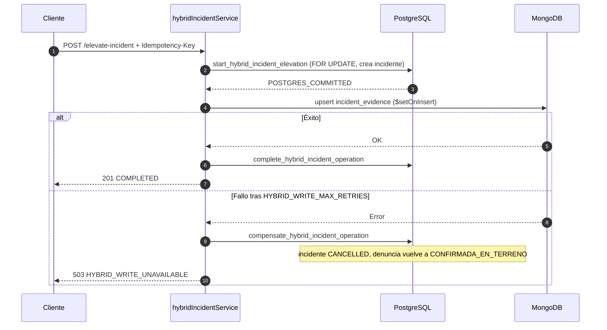
*Figura F10. Saga de elevación: éxito y compensación. Elaboración propia.*

**CAP.** Cada motor es consistente localmente. Ante la indisponibilidad de MongoDB, el sistema prefiere **no confirmar** antes que dejar un estado parcial: sacrifica temporalmente la disponibilidad de escritura para preservar la consistencia del flujo de negocio.

**Lakehouse objetivo [Diseño].**

| Zona | Contenido | Proceso (PySpark) |
|---|---|---|
| Bronze | Crudo de cada tópico Kafka, particionado por fuente y fecha | Ingesta *append-only* |
| Silver | Registros validados, georreferenciados (EPSG:4326), deduplicados, con clave por celda H3 o tile | Limpieza, conversión de unidades, descarte de nulos y fuera de rango |
| Gold | Agregados por sector y día: focos, ΔdB, ΔNDVI, turbidez media; features para ML | Ventanas temporales y uniones espaciales |

## III.5 Memoria semántica (RAG) y motor analítico

**Qué conocimiento se vectoriza:**

1. **Corpus científico.** Fragmentos por sitio de investigación con coordenadas, Hg (ppm), turbidez (NTU), hectáreas deforestadas y territorio étnico (`server.ts`, `/api/corpus/ingest`).
2. **Narrativas de anomalías satelitales** generadas por el scheduler (`content_chunk`).
3. **Minutas de campo** Kobo/ODK.
4. **Normativa.** Decretos del AMO y de las ABRAE `[Diseño]`.

**BD vectorial elegida: pgvector en Supabase**, `vector(768)` con índice HNSW. Frente a alternativas dedicadas (Qdrant, Chroma, Pinecone), pgvector permite combinar en **una sola consulta SQL** la similitud coseno y el filtro espacial `ST_DWithin` de PostGIS, sin sincronizar dos almacenes ni exponer coordenadas de comunidades a un servicio externo.

**Embeddings [Implementado].** Cada documento se vectoriza con Gemini `gemini-embedding-001`, reducido a 768 dimensiones y normalizado (`RETRIEVAL_DOCUMENT` para documentos, `RETRIEVAL_QUERY` para consultas). Los documentos se insertan sin vector y `EmbeddingWorker` los vectoriza por lotes al arrancar el servidor, tras cada ingesta del scheduler y al ingresar corpus; así, un fallo de Gemini no bloquea la ingesta. El proceso respeta la cuota gratuita de Gemini (100 textos por minuto y 1.000 por día) y se pausa si se agota. Los 1.216 documentos de la memoria semántica están vectorizados en producción.

**Generación [Implementado].** `AIModelCascadeManager` recorre 4 modelos Gemini con cuotas diarias; ante errores 429 o de cuota marca el modelo como agotado y pasa al siguiente. Si la cuota global está saturada, corta la cascada y devuelve una respuesta determinística de contingencia (`engineType: "tactical_contingency"`).

**Grafo de conocimiento [Diseño].**

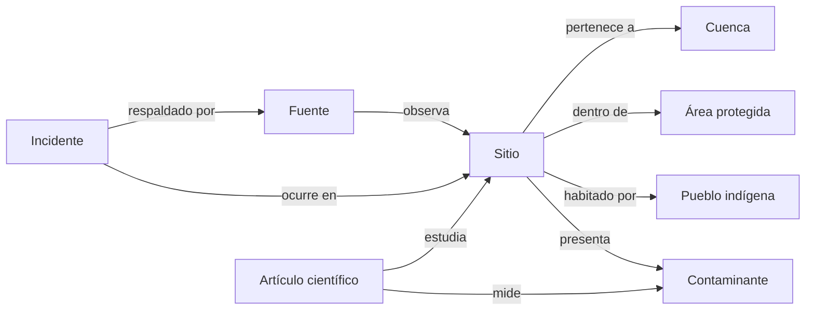

**Pipeline de filtro y reranker [Implementado; código en Anexo A.1].**

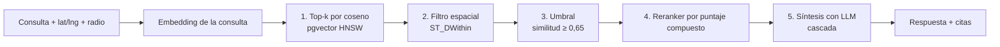
*Figura F11. Pipeline RAG. Elaboración propia.*

Puntaje compuesto del reranker:

`score = 0,45·sim + 0,20·(1 − d/R) + 0,15·e^(−días/90) + 0,10·arbitrado + 0,10·severidad`

Justificación de los pesos:

- La **similitud semántica** domina (0,45), porque es la señal principal de pertinencia.
- La **proximidad** (0,20) refleja que la evidencia cercana al punto consultado es más accionable.
- La **recencia** (0,15), con vida media de unos 62 días, prioriza actividad minera activa.
- La condición de **arbitrado** (0,10) favorece la evidencia científica revisada por pares.
- La **severidad** (0,10) desempata a favor de lo crítico.

Los pesos son iniciales y deben calibrarse con un conjunto etiquetado. Sin punto de consulta, el peso de la proximidad pasa a la similitud. Si no es posible vectorizar la consulta, la búsqueda usa coincidencia de texto y distancia geodésica.

## III.6 Flujo dinámico automatizado

En el prototipo, el flujo automático ya opera así: el scheduler ejecuta la ingesta de cada fuente con su propia cadencia, la reintenta en la siguiente ejecución si falla y, cuando entran documentos nuevos, dispara su vectorización. Agentes de IA deciden qué documentos del corpus son pertinentes para la región y qué modelo de lenguaje usar según la cuota disponible. Las reglas de alerta de la Tabla T4 completan el diseño: requieren el análisis de píxeles satelitales y se ejecutarían en un DAG de Apache Airflow.

**Orquestador actual [Implementado].** El scheduler propio ejecuta tareas por constelación y expone:

- estado: `GET /api/scheduler/status`;
- disparo manual: `POST /api/scheduler/trigger/:taskKey`;
- ejecución de tareas vencidas desde un cron externo (GitHub Actions o `pg_cron` + `pg_net`), protegida con `INGESTION_TRIGGER_TOKEN`: `POST /api/scheduler/run-due`;
- pausa: `POST /api/scheduler/toggle`;
- SQL de las migraciones aplicadas en Supabase: `GET /api/scheduler/sql-automation`.

El modo acelerado de demostración se eliminó; el scheduler opera solo con la cadencia de producción.

**Agentes de IA para enrutamiento [Implementado]:**

- geofencing del corpus;
- clasificación y síntesis de boletines (`/api/ai/generate-bulletin`);
- análisis predictivo por zona (`/api/ai/zone-predictive-analytics`, `/api/ai/analyze-zone`);
- chat operativo (`/api/ai/chat`).

**Tabla T4. Reglas de decisión automatizada [Diseño; no implementadas; umbrales iniciales a calibrar]**

| # | Condición | Acción | Responsable |
|---|---|---|---|
| R1 | Foco FIRMS con confianza alta **y** caída de retrodispersión S1 ≥ 3 dB a ≤ 2 km, dentro de ABRAE o a ≤ 5 km de territorio indígena | Crear incidente **CRITICAL**, generar boletín, notificar a la unidad de Guardería asignada, registrar en bitácora | Motor de reglas → Operador de turno |
| R2 | Turbidez > 100 NTU sostenida 3 h en estación aguas arriba de Guri | Incidente **HIGH** "sedimentación", alerta al operador del embalse | Motor de reglas → Enlace CVG/Corpoelec |
| R3 | Caída de NDVI ≥ 30 % en tile S2 respecto a la mediana de 90 días | Incidente **MEDIUM**, solicitar verificación con S1 | Analista |
| R4 | Denuncia comunitaria con ≥ 2 evidencias a ≤ 3 km de un foco FIRMS de los últimos 7 días | Elevar prioridad de validación; sugerir elevación a incidente | Operador |
| R5 | Solo foco FIRMS aislado | Registrar en bitácora, sin alerta | Automático |

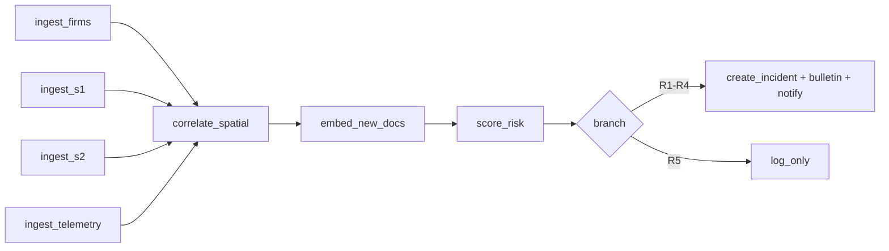
*Figura F12. DAG equivalente en Apache Airflow [Diseño]. Elaboración propia.*

**Criterios de reintento y fallo:**

- **[Diseño]** En el DAG, cada tarea de ingesta tendría 3 reintentos con espera exponencial (1, 2 y 4 min), y un fallo de ingesta no bloquearía las demás ramas (`trigger_rule="all_done"` en `correlate_spatial`).
- **[Implementado]** El scheduler actual ejecuta cada fuente como una tarea independiente: si una falla, la ejecución queda como `ERROR` o `PARTIAL` en `ingestion_runs` y la tarea se reintenta en su siguiente ejecución programada, sin afectar a las demás. Como las fuentes publican ventanas de varios días, esa ejecución recupera lo que faltó.
- **[Implementado]** La vectorización reintenta ante límites de cuota por minuto, respetando la espera que indica Gemini, y se pausa si se agota la cuota diaria.
- **[Implementado]** Si todos los LLM fallan, el boletín se genera con la plantilla determinística.
- **[Diseño]** Las reglas R1 a R5 aún no se ejecutan: R1 a R3 requieren el análisis de píxeles Sentinel.

## III.7 Capa de consumo y gobernanza

**Consumo [Implementado]** (SPA React 19 + Leaflet):

| Vista | Componente |
|---|---|
| Mapa táctico | `src/components/TacticalMap.tsx`, `GeospatialLayerToolbar.tsx` |
| Visor SAR | `SarAnomalyViewer.tsx` |
| Niveles del Orinoco (INAMEH) | `TelemetryView.tsx` |
| Corpus científico | `ScientificCorpusReader.tsx` |
| IA y chat | `AIIntelligenceView.tsx`, `AIChatDrawer.tsx` |
| Boletines | `BulletinGenerator.tsx` |
| Incidentes | `IncidentManager.tsx` |
| Denuncias | `CommunityReportsView.tsx`, `CommunityReportModal.tsx` |
| Pipeline en vivo y scheduler | `LiveIngestionPipelineView.tsx`, `SupabaseAutomationSchedulerView.tsx` |
| Exportación | `src/utils/reportExporter.ts`, `DownloadReportButton.tsx` |

`PENDIENTE: insertar capturas F15+ desde centinela-orinoco-2026.ai.studio.`

**Sobre Streamlit.** El enunciado lo menciona como ejemplo. Se optó por React porque:

- soporta varios usuarios concurrentes con roles distintos;
- integra mapas Leaflet con capas GeoJSON propias;
- se despliega como un único servicio junto con la API.

Un tablero Streamlit mínimo para analistas queda como opción (§III.10).

**Tabla T5. Matriz RBAC [Diseño; implementación con Supabase Auth + RLS]**

| Recurso \ Rol | Administrador | Operador ambiental | Analista | Comunidad |
|---|---|---|---|---|
| Denuncias: crear | ✓ | ✓ | — | ✓ |
| Denuncias: leer (con contacto) | ✓ | — | — | — |
| Denuncias: leer (anonimizadas) | ✓ | ✓ | ✓ | Solo propias |
| Denuncias: cambiar estado / elevar | ✓ | ✓ | — | — |
| Incidentes: leer | ✓ | ✓ | ✓ | — |
| Incidentes: asignar / cerrar | ✓ | ✓ | — | — |
| Corpus: ingestar | ✓ | — | ✓ | — |
| Scheduler: cambiar modo / disparar | ✓ | — | — | — |
| Coordenadas exactas de comunidades | ✓ | Con justificación registrada | — | — |

```sql
-- Ejemplo de política RLS (diseño)
create policy analyst_read_incidents on public.incidents
  for select to authenticated
  using ((auth.jwt() ->> 'app_role') in ('admin','operator','analyst'));
```

**Política de anonimización de datos indígenas:**

1. **Denuncia anónima por defecto** [Implementado]. `is_anonymous` vale `true` por defecto, y la restricción `community_reports_anonymous_privacy_chk` impide guardar `reporter_name` y `reporter_contact` en ese caso.
2. **Contacto solo en PostgreSQL** [Implementado]. Los datos de contacto nunca se copian a MongoDB (spec 02).
3. **Geo-masking** [Diseño]. Las coordenadas de comunidades y de denunciantes se generalizan a 0,01° (≈ 1,1 km) o se desplazan aleatoriamente en un anillo de 0,5–2 km para los roles sin permiso de coordenadas exactas.
4. **Logs sin PII** [Implementado según spec 01 P0.2]. Se registran `correlation_id` y `operation_id`, nunca cuerpos, contactos ni URI.
5. **Metadatos EXIF** [Diseño]. Se eliminan los datos GPS y de dispositivo de las fotos antes de exponerlas.
6. **Principios CARE** [Diseño]. El consentimiento comunitario es previo a publicar datos de territorios, y las comunidades tienen derecho a solicitar el retiro.

**Blockchain [Diseño / trabajo futuro].** Un contrato inteligente registra el hash `sha256` de cada evidencia (ya calculado en el documento MongoDB) y el identificador del incidente. Así se garantiza que la evidencia presentada ante autoridades no fue alterada. El mismo registro puede extenderse a la certificación de origen de productos comunitarios libres de minería (comercio justo, Capa 4 del enunciado).

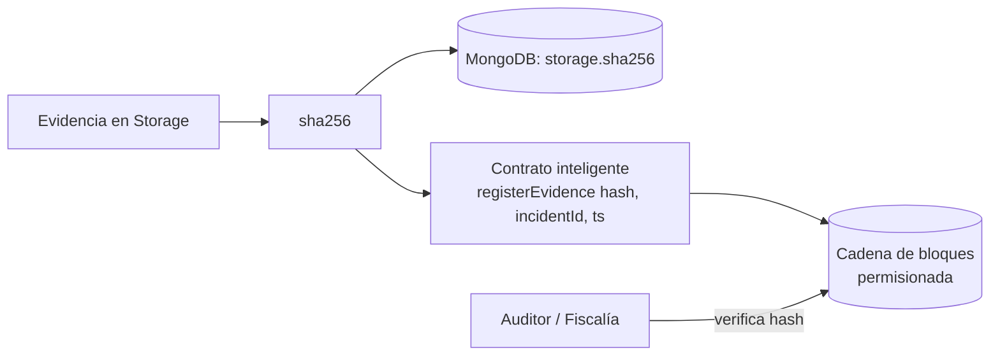

## III.8 Resiliencia de red (offline-first)

**Implementado:**

- **Reanudación de la ingesta tras fallos.** Si una fuente o Supabase falla, la ejecución queda como `ERROR` o `PARTIAL` en `ingestion_runs` y la tarea se reprograma. Como las fuentes publican ventanas de varios días (FIRMS 2 días, STAC 4 días) y la inserción descarta repetidos, la siguiente ejecución recupera lo que faltó sin duplicar (`server/satelliteScheduler.ts:364-445`).
- **Cascada LLM con respaldo determinístico.** Descrita en §III.5.
- **Respuesta de contingencia del RAG.** Cuando el LLM falla, se devuelve la lista de documentos encontrados sin síntesis de IA.
- **Idempotencia** (`Idempotency-Key`) en la elevación de incidentes. Permite reintentos seguros tras cortes.

**Diseño de borde:**

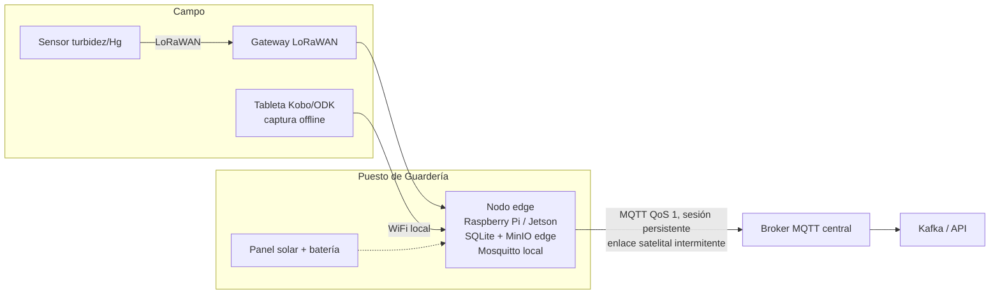
*Figura F13. Arquitectura edge → gateway → nube. Elaboración propia.*

**Cola priorizada.** Las alertas CRITICAL salen primero; luego la telemetría agregada y, por último, los binarios (fotos y video), que se envían comprimidos cuando hay ancho de banda.

**Tabla T6. Escenarios de falla**

| Escenario | Comportamiento esperado |
|---|---|
| Sin red en el puesto | El nodo edge almacena localmente; Kobo/ODK guarda formularios en el dispositivo; reglas locales simples generan alertas en sitio |
| Red intermitente | MQTT QoS 1 con sesión persistente reenvía los mensajes pendientes; la API los deduplica por `Idempotency-Key` |
| Sin energía | Energía solar con batería; escrituras con *journaling* en SQLite; al volver, se reanuda el *store-and-forward* |
| PostgreSQL caído | El scheduler marca la ejecución con error y la siguiente recupera la ventana pendiente sin duplicar [Implementado]; la saga no confirma operaciones (503) [Implementado] |
| MongoDB caído | La saga compensa en PostgreSQL y responde 503 [Implementado] |
| Todos los LLM sin cuota | Respuesta determinística de contingencia [Implementado] |

## III.9 Calidad de software

> **Estado:** `tests/` contiene 26 pruebas automatizadas con `node:test` (`npm test`) para la memoria semántica: embeddings, reranker, respaldo por texto, cuota agotada y errores de Supabase. Todas pasan. Los casos de la tabla siguiente, sobre ingesta y saga, siguen pendientes de automatizar.

**Tabla T7. Casos de prueba ante datos corruptos o vacíos**

| # | Entrada | Resultado esperado | Resultado obtenido |
|---|---|---|---|
| 1 | Boletín INAMEH vacío o sin cota legible; misma ejecución repetida | La lectura se descarta; la repetición inserta 0 registros y los cuenta como omitidos | `PENDIENTE` |
| 2 | `POST /api/corpus/ingest` con PDF vacío y sin DOI | 400 "No se pudo extraer contenido…" | `PENDIENTE` |
| 3 | DOI inexistente | Crossref sin resultado; si no hay texto, 400 | `PENDIENTE` |
| 4 | Denuncia sin coordenadas o con latitud 95 | 400 en la API; el `check` de PostgreSQL rechaza también | `PENDIENTE` |
| 5 | Fallo simulado de MongoDB durante la saga | Operación `COMPENSATED`, incidente `CANCELLED`, HTTP 503 | `PENDIENTE` |
| 6 | Misma `Idempotency-Key` con otro cuerpo | 409 `IDEMPOTENCY_CONFLICT` | `PENDIENTE` |
| 7 | Todos los modelos de la cascada fallan | `engineType: "tactical_contingency"` | `PENDIENTE` |
| 8 | Webhook Kobo con JSON malformado | 400 "Invalid webhook payload format" | `PENDIENTE` |

Plan base: [05-plan-de-implementacion-y-pruebas.md](../src/docs/specs/05-plan-de-implementacion-y-pruebas.md).

## III.10 Plan de despliegue en la nube y contenedorización

**Despliegue actual [Implementado]:**

- Google AI Studio sobre Cloud Run (`centinela-orinoco-2026.ai.studio`);
- Supabase gestionado;
- MongoDB Atlas.

**Contenedorización objetivo [Diseño; no hay Dockerfile ni Compose en el repositorio]:**

- **Docker Compose** para el entorno académico o local (Anexo A.3), con los servicios:
  - `api` y `web`;
  - `postgres` (con PostGIS y pgvector);
  - `mongodb`, `minio` y `mosquitto`;
  - opcionales: `kafka`, `airflow` y `streamlit`.
- **Kubernetes** para producción:
  - `Deployment` de la API con `HorizontalPodAutoscaler` (CPU 70 %, 2–6 réplicas);
  - `Deployment` del frontend estático detrás de `Ingress` con TLS;
  - bases de datos como servicios gestionados (Supabase, Atlas) o `StatefulSet` con volúmenes persistentes;
  - credenciales en `Secret`;
  - `CronJob` o Airflow para las tareas de ingesta.

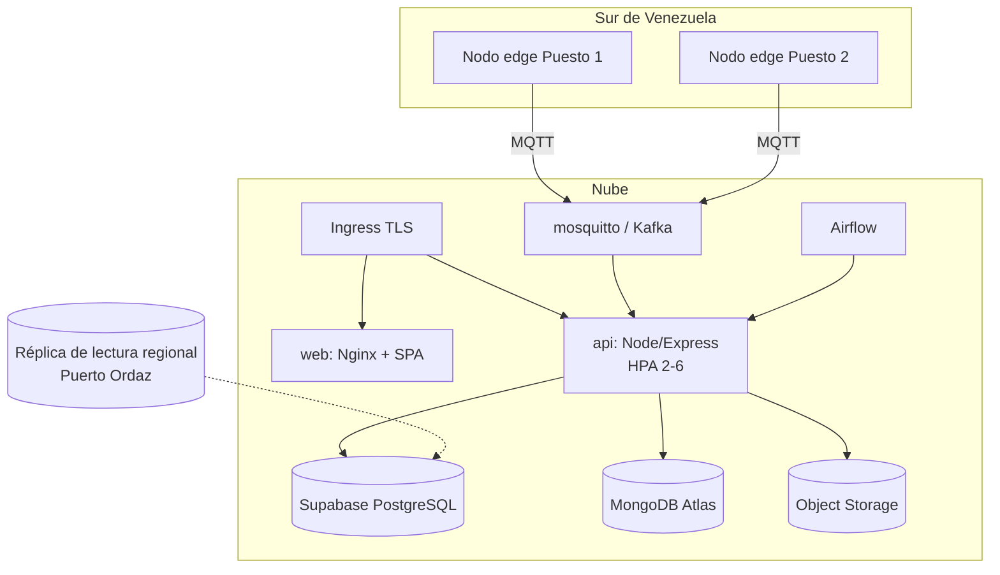
*Figura F14. Despliegue híbrido nube + borde. Elaboración propia.*

**Restricciones del sur de Venezuela:**

- **Despliegue híbrido.** El núcleo corre en la nube y los nodos edge en los puestos de Guardería.
- **Réplica de lectura regional.** Una réplica en Puerto Ordaz reduce la latencia de consulta.
- **Degradación controlada.** El sistema prioriza la captura sobre el análisis cuando no hay enlace.

**Variables de entorno (sin secretos; basadas en `.env.example`):**

- `GEMINI_API_KEY`, `APP_URL`;
- `SUPABASE_URL`, `SUPABASE_SERVICE_ROLE_KEY`, `VITE_SUPABASE_URL`, `VITE_SUPABASE_ANON_KEY`, `SUPABASE_EVIDENCE_BUCKET`;
- `MONGODB_URI`, `MONGODB_USERNAME`, `MONGODB_PASSWORD`, `MONGODB_DATABASE`, `MONGODB_INCIDENT_EVIDENCE_COLLECTION`, `MONGODB_SERVER_SELECTION_TIMEOUT_MS`;
- `HYBRID_WRITE_MAX_RETRIES`, `HYBRID_WRITE_TIMEOUT_MS`;

## III.11 Resultado esperado para el usuario final

**Tabla T8. Usuario → beneficio**

| Usuario | Necesidad | Funcionalidad | Beneficio concreto (meta medible) |
|---|---|---|---|
| Guardería Ambiental / guardabosques | Saber dónde intervenir primero | Alertas priorizadas (T4), mapa táctico, incidentes asignados | Reducir de días a < 24 h el tiempo entre detección satelital e inicio de verificación `PENDIENTE: línea base` |
| Científicos | Encontrar evidencia previa por lugar y tema | Corpus georreferenciado con búsqueda semántica | Consultar en una sola búsqueda la literatura y la evidencia en un radio dado |
| Comunidades indígenas | Denunciar sin exponerse | Canal anónimo con evidencia y seguimiento por código | Denuncias sin datos personales almacenados (garantizado por restricción de BD) |
| Tomadores de decisión | Información consolidada | Boletines generados por IA y reportes exportables | Boletín periódico por cuenca sin elaboración manual |
| Operador de Guri / CVG | Anticipar sedimentación | Alerta R2 por turbidez aguas arriba | Aviso antes de que el pulso de sedimento llegue al embalse |

---

# CAPÍTULO IV. Conclusiones, recomendaciones y repositorio técnico

## IV.1 Factibilidad a mediano plazo

- **Técnica.** Alta.
  - Las fuentes satelitales clave (FIRMS, Copernicus) son gratuitas y abiertas.
  - La pila propuesta es de código abierto.
  - El núcleo de persistencia ya funciona.
  - El principal riesgo técnico es la calibración de las reglas con datos reales.
- **Operativa.** Media.
  - Requiere capacitar a la Guardería en el uso del tablero y de Kobo/ODK.
  - Requiere instalar nodos edge con energía solar en puestos remotos.
  - La conectividad satelital disponible condiciona la latencia.
- **Económica.** Media-alta.
  - Costos estimados: servicios gestionados en planes básicos `PENDIENTE: estimar USD/mes`; nodo edge con panel solar `PENDIENTE: estimar USD/unidad`; LLM y embeddings dentro de cuotas gratuitas o de bajo costo gracias a la cascada.
- **Legal y ética.**
  - Requiere acuerdos de consentimiento con las comunidades bajo principios CARE.
  - Requiere coordinación con los organismos competentes para que las alertas tengan valor operativo.
  - La anonimización por diseño reduce el riesgo para los denunciantes.

## IV.2 Conclusiones

1. **OE1.** Se caracterizaron ocho fuentes de datos (T1), cinco de ellas con ingesta real automatizada, y se mostró que su heterogeneidad (variedad), su cadencia (velocidad) y su incertidumbre (veracidad) exceden la capacidad de un sistema transaccional tradicional.
2. **OE2.** Se diseñó una arquitectura por capas con persistencia políglota. Su núcleo, la saga PostgreSQL–MongoDB con idempotencia y compensación, está implementado, con restricciones de integridad verificables en las migraciones. La resiliencia offline está implementada en el servidor y diseñada para el borde.
3. **OE3.** Se implementó una memoria semántica georreferenciada sobre pgvector y PostGIS: los documentos se vectorizan con Gemini y la búsqueda combina similitud coseno y radio geográfico en una sola consulta, con un reranker compuesto y respaldo por texto. El pipeline de ingesta del corpus y el geofencing semántico funcionan. Falta calibrar el umbral y los pesos con consultas etiquetadas.
4. **OE4.** El scheduler automatiza la ingesta real de FIRMS, Sentinel-1/2/3 e INAMEH con cadencias de producción, sin duplicados y con historial de ejecuciones. También se formalizaron cinco reglas de decisión y su DAG equivalente en Airflow. Las reglas están diseñadas, no implementadas.
5. **OE5.** La capa de consumo está prototipada en React con más de diez vistas operativas. La memoria semántica tiene 26 pruebas automatizadas; las pruebas de ingesta y saga ante datos corruptos o vacíos están especificadas (T7), pero aún no automatizadas.

## IV.3 Recomendaciones y trabajo futuro

1. Calibrar el umbral de similitud (0,65) y los pesos del reranker con consultas etiquetadas.
2. Agregar a `tests/` los casos de T7, y crear el `Dockerfile` y el `docker-compose.yml` (Anexo A.3).
3. Pasar del catálogo a los píxeles: descargar bandas Sentinel-1/2 y calcular retrodispersión, NDVI y turbidez sobre las escenas ya registradas.
4. Migrar la ingesta a Kafka y el histórico a Delta Lake/MinIO con Spark.
5. Entrenar modelos de detección (CNN sobre Sentinel-1/2) con datos etiquetados de la región.
6. Construir un gemelo digital de la cuenca del Caroní.
7. Desplegar el contrato inteligente de trazabilidad de evidencias.
8. Implementar el patrón *transactional outbox* para reemplazar la compensación síncrona.
9. Validar el sistema en campo con la Guardería Ambiental.

## IV.4 Repositorio técnico

- **URL:** `PENDIENTE` · **Rama:** `main` · **Commit de entrega:** `PENDIENTE`

```
centinela-orinoco-2026/
├── server.ts, server/           API, scheduler, IA, servicios (saga, denuncias)
├── src/                         SPA React (componentes, datos, specs internas)
├── supabase/migrations/         DDL y RPC de persistencia híbrida
├── server/scripts/              Inicialización y verificación de MongoDB
├── public/data/                 Capas GeoJSON de Venezuela y la cuenca
├── docs/                        Enunciado, specs del informe, este informe
├── .env.example                 Variables sin secretos
├── Dockerfile, docker-compose.yml   PENDIENTE
├── pipelines/                   PENDIENTE (PySpark, DAG Airflow, publicador MQTT)
└── tests/                       Pruebas node:test (npm test)
```

---

# R. Referencias

*Formato APA 7.ª edición. Todos los DOI se verificaron en Crossref o DataCite el 15/10/2026. La indexación en Scopus, WoS o SciELO está pendiente de confirmar donde se indica en §II.2.*

Arafat, Y., Akula, D. K., Mohammed, Y. S., & Haque, G. M. M. (2025). Big data analytics in information systems research: Current landscape and future prospects. *The American Journal of Engineering and Technology, 7*(08), 177–201. https://doi.org/10.37547/tajet/volume07issue08-16

Asner, G. P., & Tupayachi, R. (2017). Accelerated losses of protected forests from gold mining in the Peruvian Amazon. *Environmental Research Letters, 12*(9), 094004. https://doi.org/10.1088/1748-9326/aa7dab

Caballero Espejo, J., Messinger, M., Román-Dañobeytia, F., Ascorra, C., Fernandez, L., & Silman, M. (2018). Deforestation and forest degradation due to gold mining in the Peruvian Amazon: A 34-year perspective. *Remote Sensing, 10*(12), 1903. https://doi.org/10.3390/rs10121903

Camalan, S., Cui, K., Pauca, V. P., Alqahtani, S., Silman, M., Chan, R., Plemmons, R. J., Dethier, E. N., Fernandez, L. E., & Lutz, D. A. (2022). Change detection of Amazonian alluvial gold mining using deep learning and Sentinel-2 imagery. *Remote Sensing, 14*(7), 1746. https://doi.org/10.3390/rs14071746

Carroll, S. R., Garba, I., Figueroa-Rodríguez, O. L., Holbrook, J., Lovett, R., Materechera, S., Parsons, M., Raseroka, K., Rodriguez-Lonebear, D., Rowe, R., Sara, R., Walker, J. D., Anderson, J., & Hudson, M. (2020). The CARE principles for Indigenous data governance. *Data Science Journal, 19*, 43. https://doi.org/10.5334/dsj-2020-043

Colmenares, M. (2024). El arco minero del Orinoco (AMO) y la vulnerabilidad del territorio venezolano (2016-2023): Una mirada desde la historia ambiental. *Procesos Históricos*, (45), 100–123. https://doi.org/10.53766/prohis/2024.45.06

de Bruyn, C., Said, F. B., Venter, M., & Castanho, R. A. (2026). Are smart technologies enough to build climate-resilient cities? A bibliometric assessment of global trends and research gaps. *City and Environment Interactions, 29*, 100306. https://doi.org/10.1016/j.cacint.2026.100306

Gao, Y., Xiong, Y., Gao, X., Jia, K., Pan, J., Bi, Y., Dai, Y., Sun, J., Wang, M., & Wang, H. (2023). *Retrieval-augmented generation for large language models: A survey* (arXiv:2312.10997). arXiv. https://doi.org/10.48550/arXiv.2312.10997

García-Sánchez, A., Contreras, F., Adams, M., & Santos, F. (2006). Atmospheric mercury emissions from polluted gold mining areas (Venezuela). *Environmental Geochemistry and Health, 28*(6), 529–540. https://doi.org/10.1007/s10653-006-9049-x

Gerson, J. R., Szponar, N., Zambrano, A. A., Bergquist, B., Broadbent, E., Driscoll, C. T., Erkenswick, G., Evers, D. C., Fernandez, L. E., Hsu-Kim, H., Inga, G., Lansdale, K. N., Marchese, M. J., Martinez, A., Moore, C., Pan, W. K., Purizaca, R. P., Sánchez, V., Silman, M., . . . Bernhardt, E. S. (2022). Amazon forests capture high levels of atmospheric mercury pollution from artisanal gold mining. *Nature Communications, 13*, 559. https://doi.org/10.1038/s41467-022-27997-3

Le, T. V., & Fan, R. (2024). Digital twins for logistics and supply chain systems: Literature review, conceptual framework, research potential, and practical challenges. *Computers & Industrial Engineering, 187*, 109768. https://doi.org/10.1016/j.cie.2023.109768

Lewis, P., Perez, E., Piktus, A., Petroni, F., Karpukhin, V., Goyal, N., Küttler, H., Lewis, M., Yih, W., Rocktäschel, T., Riedel, S., & Kiela, D. (2020). *Retrieval-augmented generation for knowledge-intensive NLP tasks* (arXiv:2005.11401). arXiv. https://doi.org/10.48550/arXiv.2005.11401

Lobo, F. L., Costa, M. P. F., & Novo, E. M. L. M. (2015). Time-series analysis of Landsat-MSS/TM/OLI images over Amazonian waters impacted by gold mining activities. *Remote Sensing of Environment, 157*, 170–184. https://doi.org/10.1016/j.rse.2014.04.030

Malkov, Y. A., & Yashunin, D. A. (2020). Efficient and robust approximate nearest neighbor search using hierarchical navigable small world graphs. *IEEE Transactions on Pattern Analysis and Machine Intelligence, 42*(4), 824–836. https://doi.org/10.1109/TPAMI.2018.2889473

Pereira, D. H. C., Gomes, R. A. T., Carvalho Júnior, O. A. de, & Guimarães, R. F. (2024). Avaliação das imagens SAR/Sentinel-1 para identificação de garimpos de ouro embarcados por meio de algoritmos de detecção de embarcações. *Caminhos de Geografia, 25*(98), 150–169. https://doi.org/10.14393/rcg259869530

Pimenow, S., Pimenowa, O., Prus, P., & Niklas, A. (2025). The impact of artificial intelligence on the sustainability of regional ecosystems: Current challenges and future prospects. *Sustainability, 17*(11), 4795. https://doi.org/10.3390/su17114795

Rodríguez, I., & Aguilar, V. (2023). Games of power in conflicts over extractivism in Canaima National Park, Venezuela. En *Just transformations* (pp. 104–131). https://doi.org/10.2307/jj.8501592.7 `PENDIENTE: completar editores y editorial`

Rosli, A. N., Mohamad, R., Mohamad Yusof, Y. W., Shahbudin, S., & Abdul Rahman, F. Y. (2020). Implementation of MQTT and LoRaWAN system for real-time environmental monitoring application. En *2020 IEEE 10th Symposium on Computer Applications & Industrial Electronics (ISCAIE)* (pp. 287–291). IEEE. https://doi.org/10.1109/ISCAIE47305.2020.9108808

Siqueira-Gay, J., & Sánchez, L. E. (2021). The outbreak of illegal gold mining in the Brazilian Amazon boosts deforestation. *Regional Environmental Change, 21*(2), 28. https://doi.org/10.1007/s10113-021-01761-7

Sonter, L. J., Herrera, D., Barrett, D. J., Galford, G. L., Moran, C. J., & Soares-Filho, B. S. (2017). Mining drives extensive deforestation in the Brazilian Amazon. *Nature Communications, 8*, 1013. https://doi.org/10.1038/s41467-017-00557-w

Valbuena Gaona, M. P., Ferrucho Parra, C. C., Prieto Arenas, M. A., & Muñoz Bravo, G. A. (2024). Tool to generate deforestation and illegal mining alerts with remote sensing. *Environmental Sciences Proceedings, 28*(1), 27. https://doi.org/10.3390/environsciproc2023028027

Vishwakarma, A. K., Patro, P. K., & Acquaye, A. (2025). Applications of AI to low carbon decision support system for global supply chains. *Cleaner Logistics and Supply Chain, 17*, 100261. https://doi.org/10.1016/j.clscn.2025.100261

`PENDIENTE: agregar Borjas (AmazonIA 4.0), documento UNESCO, Gaceta Oficial del AMO y una fuente indexada sobre Hg en población indígena venezolana.`

---

# A. Anexos

## A.1 Filtro y reranker (implementado)

Archivo: `server/rag/reranker.ts`

```typescript
/**
 * Reranker de la memoria semántica (ecuación 1 del artículo):
 * score = 0,45·sim + 0,20·(1 − d/R) + 0,15·e^(−días/90) + 0,10·arbitrado + 0,10·severidad
 * Sin punto de consulta (o sin radio) no hay proximidad: su peso pasa a la similitud.
 * Los pesos son iniciales y no están calibrados con un conjunto etiquetado.
 */

export interface RerankCandidate {
  id: string;
  doc_type: string;
  similarity: number;
  distance_km: number | null;
  created_at: string;
  metadata: Record<string, any> | null;
}

export interface RerankOptions {
  radiusKm?: number;
  topN?: number;
  now?: Date;
  weights?: Partial<RerankWeights>;
}

export interface RerankWeights {
  similarity: number;
  proximity: number;
  recency: number;
  peerReviewed: number;
  severity: number;
}

export const DEFAULT_WEIGHTS: RerankWeights = {
  similarity: 0.45,
  proximity: 0.2,
  recency: 0.15,
  peerReviewed: 0.1,
  severity: 0.1,
};

export const RECENCY_TAU_DAYS = 90;

const SEVERITY_SCORE: Record<string, number> = { LOW: 0.25, MEDIUM: 0.5, HIGH: 0.75, CRITICAL: 1 };
const FIRMS_CONFIDENCE_SCORE: Record<string, number> = { low: 0.25, nominal: 0.5, high: 0.75 };
const HYDRO_ALERT_SCORE: Record<string, number> = { ALERT_CRECIDA: 1, ELEVATED: 0.5, OPTIMAL: 0, SIN_REFERENCIA: 0 };

/** Severidad en [0, 1] según lo que trae cada tipo de documento; 0 si no hay dato. */
export function severityOf(metadata: Record<string, any> | null | undefined): number {
  if (!metadata) return 0;
  if (typeof metadata.severity === "string" && metadata.severity in SEVERITY_SCORE) return SEVERITY_SCORE[metadata.severity];
  if (typeof metadata.alert_status === "string" && metadata.alert_status in HYDRO_ALERT_SCORE) return HYDRO_ALERT_SCORE[metadata.alert_status];
  if (typeof metadata.confidence === "string" && metadata.confidence in FIRMS_CONFIDENCE_SCORE) return FIRMS_CONFIDENCE_SCORE[metadata.confidence];
  return 0;
}

export interface RerankedCandidate<T extends RerankCandidate> {
  candidate: T;
  score: number;
  components: { similarity: number; proximity: number; recency: number; peerReviewed: number; severity: number };
}

export function rerank<T extends RerankCandidate>(candidates: T[], options: RerankOptions = {}): RerankedCandidate<T>[] {
  const base = { ...DEFAULT_WEIGHTS, ...options.weights };
  const radius = options.radiusKm;
  const useProximity = Number.isFinite(radius) && (radius as number) > 0;
  const weights = useProximity ? base : { ...base, similarity: base.similarity + base.proximity, proximity: 0 };
  const now = (options.now ?? new Date()).getTime();

  return candidates
    .filter(c => Number.isFinite(c.similarity))
    .filter(c => !useProximity || c.distance_km === null || !Number.isFinite(c.distance_km) || c.distance_km <= (radius as number))
    .map(candidate => {
      const ageDays = Math.max(0, (now - Date.parse(candidate.created_at)) / 86_400_000);
      const components = {
        similarity: Math.min(1, Math.max(0, candidate.similarity)),
        proximity: useProximity && candidate.distance_km !== null && Number.isFinite(candidate.distance_km)
          ? Math.max(0, 1 - candidate.distance_km / (radius as number))
          : 0,
        recency: Number.isFinite(ageDays) ? Math.exp(-ageDays / RECENCY_TAU_DAYS) : 0,
        peerReviewed: candidate.metadata?.peer_reviewed === true ? 1 : 0,
        severity: severityOf(candidate.metadata),
      };
      const score =
        weights.similarity * components.similarity +
        weights.proximity * components.proximity +
        weights.recency * components.recency +
        weights.peerReviewed * components.peerReviewed +
        weights.severity * components.severity;
      return { candidate, score: Math.round(score * 10000) / 10000, components };
    })
    .sort((a, b) => b.score - a.score)
    .slice(0, Math.max(1, options.topN ?? 8));
}
```

## A.2 DDL y RPC de búsqueda vectorial espacial (implementado)

Archivo: `supabase/migrations/202610260001_rag_vector_search.sql`, aplicada en Supabase de producción.

```sql
-- =============================================================================
-- Centinela Orinoco: memoria semántica vectorial y espacial.
-- Agrega el embedding (Gemini gemini-embedding-001, 768 dimensiones) y una
-- geometría a environmental_rag_documents, y la RPC que combina similitud
-- coseno y distancia geodésica en una sola consulta. Los documentos se
-- insertan sin embedding; el servidor los vectoriza después por lotes.
-- =============================================================================

begin;

set local search_path to 'public', 'extensions';

create extension if not exists vector with schema extensions;

-- -----------------------------------------------------------------------------
-- 1. Columnas
-- -----------------------------------------------------------------------------
alter table public.environmental_rag_documents
  add column if not exists embedding vector(768),
  add column if not exists embedding_model text,
  add column if not exists embedded_at timestamptz;

alter table public.environmental_rag_documents
  add column if not exists geom geometry(Point, 4326) generated always as (
    case when latitude is not null and longitude is not null
      then st_setsrid(st_makepoint(longitude, latitude), 4326) end
  ) stored;

-- -----------------------------------------------------------------------------
-- 2. Índices
-- -----------------------------------------------------------------------------
create index if not exists idx_rag_documents_embedding_hnsw
  on public.environmental_rag_documents
  using hnsw (embedding vector_cosine_ops) with (m = 16, ef_construction = 64);

create index if not exists idx_rag_documents_geom
  on public.environmental_rag_documents using gist (geom);

-- Documentos pendientes de vectorizar (el worker los busca en cada pasada).
create index if not exists idx_rag_documents_pending_embedding
  on public.environmental_rag_documents (created_at)
  where embedding is null;

-- -----------------------------------------------------------------------------
-- 3. Búsqueda: similitud coseno + filtro espacial opcional
-- -----------------------------------------------------------------------------
create or replace function public.match_environmental_documents(
  query_embedding vector(768),
  p_lat double precision default null,
  p_lng double precision default null,
  p_radius_km double precision default null,
  p_threshold double precision default 0.65,
  p_k integer default 20
)
returns table (
  id uuid,
  doc_type text,
  source_reference_id text,
  title text,
  location_name text,
  sub_basin text,
  latitude double precision,
  longitude double precision,
  content_chunk text,
  metadata jsonb,
  created_at timestamptz,
  similarity double precision,
  distance_km double precision
)
language sql
stable
set search_path to 'public', 'extensions'
as $$
  with target as (
    select case when p_lat is not null and p_lng is not null
      then st_setsrid(st_makepoint(p_lng, p_lat), 4326)::geography end as point
  )
  select
    d.id,
    d.doc_type,
    d.source_reference_id,
    d.title,
    d.location_name,
    d.sub_basin,
    d.latitude,
    d.longitude,
    d.content_chunk,
    d.metadata,
    d.created_at,
    1 - (d.embedding <=> query_embedding) as similarity,
    case when t.point is not null and d.geom is not null
      then st_distance(d.geom::geography, t.point) / 1000.0 end as distance_km
  from public.environmental_rag_documents d
  cross join target t
  where d.embedding is not null
    and 1 - (d.embedding <=> query_embedding) >= p_threshold
    and (
      t.point is null
      or p_radius_km is null
      or (d.geom is not null and st_dwithin(d.geom::geography, t.point, p_radius_km * 1000))
    )
  order by d.embedding <=> query_embedding
  limit least(greatest(coalesce(p_k, 20), 1), 100);
$$;

revoke all on function public.match_environmental_documents(vector, double precision, double precision, double precision, double precision, integer) from public, anon, authenticated;
grant execute on function public.match_environmental_documents(vector, double precision, double precision, double precision, double precision, integer) to service_role;

commit;
```

## A.3 Docker Compose (propuesta)

```yaml
services:
  api:
    build: .
    env_file: .env
    ports: ["3000:3000"]
    depends_on: [postgres, mongodb, mosquitto]
  postgres:
    image: postgis/postgis:16-3.4   # agregar pgvector en una imagen derivada
    environment:
      POSTGRES_DB: centinela
      POSTGRES_PASSWORD: ${POSTGRES_PASSWORD}
    volumes:
      - pgdata:/var/lib/postgresql/data
      - ./supabase/migrations:/docker-entrypoint-initdb.d:ro
  mongodb:
    image: mongo:7
    volumes: [mongodata:/data/db]
  minio:
    image: minio/minio
    command: server /data --console-address ":9001"
    environment:
      MINIO_ROOT_USER: ${MINIO_ROOT_USER}
      MINIO_ROOT_PASSWORD: ${MINIO_ROOT_PASSWORD}
    volumes: [miniodata:/data]
  mosquitto:
    image: eclipse-mosquitto:2
    ports: ["1883:1883"]
volumes:
  pgdata:
  mongodata:
  miniodata:
```

> Las migraciones actuales usan roles de Supabase (`service_role`, `anon`, `authenticated`). Para ejecutarlas en un PostgreSQL local hay que crear esos roles antes o adaptar los `grant`.

## A.4 Fragmentos de código implementado

`PENDIENTE: incluir, con ruta de origen:`

- `server/services/hybridIncidentService.ts` (saga);
- la restricción de anonimato de `202610140001_hybrid_persistence_base.sql`;
- la cascada de `server/aiModelManager.ts`;
- el geofencing de `/api/corpus/ingest`;
- `src/components/TacticalMap.tsx` (interfaz).

## A.5 Cronograma

`PENDIENTE: cronograma de la Fase I (entrega de la propuesta el 13/08/26) y de la fase técnica hasta la entrega final.`
