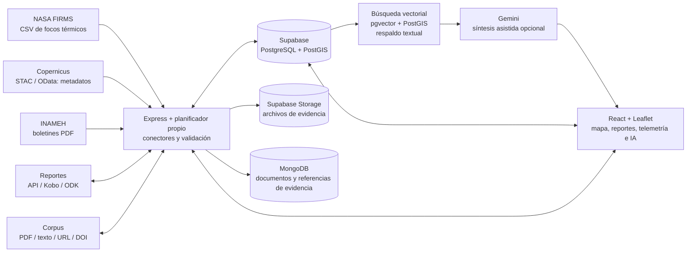

# Universidad Nacional Experimental de Guayana

**Maestría en Tecnologías de la Información** 
**Arquitecturas de Datos Inteligentes**

## Proyecto Integrador

# Centinela Orinoco

### Arquitectura de datos inteligentes para la detección temprana y el monitoreo de la minería ilegal en el Arco Minero del Orinoco

**Informe técnico del prototipo** 
**Sede:** Puerto Ordaz 
**Cohorte:** IX 
**Período:** Trimestre III, 2026 
**Asignatura:** Seminario I: Arquitectura de Datos Inteligentes 
**Profesora:** PhD. Livia Carolina Borjas Medina

**Integrantes:**

- Julio Cesar Canelón Rangel
- José Francisco Escalante Rosales
- Miguel Damián Mota Garrido

**Fecha:** octubre de 2026 
**Fecha de evaluación tecnológica:** 25 de octubre de 2026

---

## Resumen ejecutivo

Centinela Orinoco es una arquitectura de datos inteligente en fase de prototipo que integra fuentes geoespaciales, ambientales, comunitarias y científicas en cuatro capas: ingesta, almacenamiento, inteligencia y consumo. La solución consulta NASA FIRMS, los catálogos Copernicus STAC/OData y boletines hidrológicos del INAMEH; combina PostgreSQL/PostGIS y pgvector, MongoDB y almacenamiento de objetos para la persistencia y gestión de evidencias.

La versión evaluada incorpora ingesta automatizada de cinco fuentes satelitales e hidrológicas, deduplicación, un canal de denuncias y una memoria semántica georreferenciada con embeddings de Gemini. La búsqueda vectorial combina similitud coseno con un filtro espacial PostGIS y un reranker compuesto; si la consulta no puede vectorizarse o no supera el umbral, se activa una búsqueda textual. Sentinel-1, Sentinel-2 y Sentinel-3 aportan metadatos de catálogo, no análisis de píxeles; el INAMEH aporta niveles publicados, no telemetría directa ni mediciones de calidad del agua. La síntesis de Gemini es apoyo a la revisión y no confirma alertas ni ordena acciones en terreno.

La persistencia híbrida de denuncias e incidentes contempla idempotencia y compensación ante fallos. El análisis de imágenes, el Lakehouse, Airflow, el almacenamiento edge durable, MQTT/LoRaWAN, RBAC integral y la contenedorización permanecen como trabajo futuro. El artículo IEEE presenta 12 antecedentes, aunque la indexación de varias fuentes aún requiere verificación. Los resultados cuantitativos y la aplicación en producción se consignan como reportados por el artículo, pues no pudieron contrastarse con credenciales ni con una instancia de producción durante esta evaluación.

---

## Delimitación metodológica

El análisis contrasta los lineamientos académicos con el artículo IEEE, el informe preliminar y las capacidades observables de la versión local del prototipo. Se distinguen las funciones presentes en la implementación, los resultados declarados por los documentos y los componentes que permanecen como diseño. La existencia de una integración no demuestra por sí sola que las credenciales estén configuradas ni que el servicio externo opere de forma continua.

La revisión se efectuó al 25 de octubre de 2026. Se comprobó la presencia de módulos para embeddings, búsqueda vectorial espacial, reranking y pruebas automatizadas; sin embargo, no se ejecutaron las pruebas porque `tsx` no está disponible en el entorno. Tampoco se validaron credenciales de NASA FIRMS, Supabase, MongoDB, Gemini o INAMEH ni el estado del despliegue público. El informe preliminar contiene una nota fechada el 26 de octubre de 2026, posterior al corte de esta revisión; por ello, las afirmaciones vinculadas a esa actualización se presentan como información declarada en la fuente y no como hechos verificados de manera independiente. La cobertura de datos depende de la disponibilidad, los límites y las condiciones de acceso de cada servicio. Las capas cartográficas estáticas y los contenidos demostrativos deben distinguirse de las observaciones externas.

# Capítulo I. Diagnóstico territorial y planteamiento del problema

## 1.1 Contextualización

El proyecto aborda la detección temprana y el monitoreo de actividades mineras no reguladas y de sus posibles efectos ambientales en la cuenca del Orinoco, con énfasis en Bolívar y Amazonas y consideración de Delta Amacuro por su relación hidrológica. Según el artículo IEEE, el Arco Minero del Orinoco comprende 111.843,70 km², aproximadamente el 12,2 % del territorio nacional; esta cifra se atribuye al Decreto N.º 2.248 y debe presentarse junto con la referencia oficial correspondiente. El área se relaciona con las cuencas del Caroní, Caura y Cuyuní, el embalse de Guri, el distrito aurífero de El Callao y áreas protegidas como Canaima y Yapacana.

La problemática comprende pérdida de cobertura vegetal, alteración de ríos y sedimentos, exposición potencial al mercurio y afectación de comunidades indígenas, entre ellas pueblos Pemón, Ye'kwana, Sanemá, Piaroa y Curripaco. Los estudios citados por el artículo describen impactos de la minería en la Amazonía brasileña y peruana y antecedentes de contaminación por mercurio en Venezuela; la magnitud de esos resultados no debe extrapolarse directamente al área de estudio sin mediciones locales.

La problemática tecnológica se vincula con la dispersión de fuentes que presentan formatos, escalas espaciales y frecuencias de actualización heterogéneas, entre ellas productos satelitales, boletines hidrológicos, documentos científicos y reportes comunitarios. En territorios remotos, la conectividad intermitente y la sensibilidad de la información comunitaria requieren mecanismos de resiliencia, trazabilidad, privacidad y revisión humana. La integración de estas fuentes puede facilitar su consulta contextual; sin embargo, no sustituye la observación de campo ni constituye evidencia suficiente de la ocurrencia de minería ilegal.

## 1.2 Problema específico

La fragmentación de los sistemas de información dificulta contextualizar una anomalía remota junto con registros hidrológicos, reportes locales y antecedentes científicos. La ausencia de trazabilidad, control de calidad y criterios de corroboración puede conducir a interpretaciones parciales o a atribuir una señal a una causa distinta de la que la originó. Los antecedentes revisados documentan deforestación asociada a la minería, acumulación de mercurio en ecosistemas próximos a explotaciones auríferas y aumento de sedimentos en aguas amazónicas; para el sur venezolano se requieren fuentes y mediciones territoriales específicas.

Centinela Orinoco incorpora conectores para algunas fuentes y una interfaz común de consulta. La cobertura de la ingesta es parcial: se consultan focos térmicos y catálogos de productos satelitales, pero no se descargan ni procesan imágenes para detectar cambios de cobertura. Los niveles de los ríos se obtienen de boletines publicados por el INAMEH, sin conexión directa a sensores. En consecuencia, el prototipo no acredita una capacidad operacional para detectar minería ni permite inferir la calidad del agua a partir de los datos actualmente disponibles.

## 1.3 Datos considerados y situación comprobada

| Fuente | Datos considerados | Alcance actual de la integración |
| --- | --- | --- |
| Fuente | Datos considerados | Alcance actual de la integración |
| --- | --- | --- |
| NASA FIRMS (VIIRS NOAA-20, VIIRS S-NPP, MODIS NRT) | Coordenadas, fecha, temperatura de brillo, confianza y potencia radiativa | Consulta CSV de focos en una ventana de dos días, normalización y filtrado territorial. Cadencia nominal: 3 h; requiere `FIRMS_MAP_KEY` y conectividad. |
| Copernicus Sentinel-1 SAR | Escenas GRD, modo, polarización, órbita y huella | Catálogo STAC consultado cada 12 h; no se descargan escenas ni se analizan retrodispersión o coherencia. |
| Copernicus Sentinel-2 MSI | Productos L2A, nubosidad, órbita y huella | Catálogo STAC consultado cada 24 h; no se descargan bandas ni se calculan NDVI o turbidez. |
| Copernicus Sentinel-3 OLCI/SLSTR | Tipo de producto, fechas, tamaño y cobertura | Catálogo OData consultado cada 24 h; no se descargan ni procesan los productos. |
| INAMEH | Nivel del Orinoco, variación diaria, tendencia y cota de desborde | Boletines PDF de cuatro estaciones, consultados cada 6 h; no son sensores en tiempo real y no proporcionan Hg, pH o turbidez en esta integración. |
| KoboToolbox / ODK | Minutas, fotografías y coordenadas | Se contemplan webhooks para formularios; la conexión efectiva depende de configuración externa. |
| Denuncias comunitarias | Texto, imagen, video y geolocalización | API de reportes y flujo de elevación a incidente; la persistencia y evidencia requieren Supabase y almacenamiento asociado. |
| Corpus científico | PDF, DOI, URL y texto | Extracción documental, consulta de metadatos Crossref y clasificación asistida; la clasificación automatizada no acredita arbitraje ni indexación. |

El artículo IEEE consigna, con corte declarado al 25 de octubre de 2026 a las 23:37 UTC, 2.890 focos FIRMS, 52 escenas Sentinel-1, 139 productos Sentinel-2, 105 productos Sentinel-3, ocho lecturas hidrológicas y 1.216 documentos vectorizados; también informa 25 ejecuciones recientes exitosas. Estas cifras se incluyen como resultados reportados por el artículo, no como mediciones verificadas durante la presente revisión. La persistencia de dichos registros depende de la configuración de Supabase y de la disponibilidad de las fuentes.

## 1.4 Objetivo del proyecto

Diseñar y prototipar una arquitectura de datos inteligente que apoye la integración y el análisis contextual de señales ambientales y reportes comunitarios relacionados con la minería ilegal en el Arco Minero del Orinoco.

### Objetivos específicos

1. Integrar en una interfaz geoespacial capas de alertas, estaciones, áreas protegidas, incidentes y denuncias.
2. Implementar conectores para fuentes satelitales, boletines hidrológicos y documentos científicos, con persistencia de registros y procedencia.
3. Implementar persistencia híbrida para denuncias, incidentes y evidencias asociadas.
4. Explorar el análisis asistido por modelos Gemini y la síntesis contextual para apoyar la revisión humana.
5. Identificar las brechas técnicas, científicas y de gobernanza necesarias para evolucionar a una solución validable en campo.

## 1.5 Justificación y aporte

La propuesta se articula con AmazonIA 4.0 al combinar datos territoriales, herramientas de inteligencia artificial y una interfaz de apoyo a decisiones ambientales. El artículo relaciona el proyecto con la Estrategia del Programa sobre el Hombre y la Biosfera de la UNESCO y su Plan de Acción de Lima. La referencia institucional debe completarse en la bibliografía y no sustituye las fuentes científicas del problema.

El aporte tecnológico consiste en integrar fuentes heterogéneas, implementar una memoria semántica georreferenciada y establecer un flujo controlado para promover una denuncia confirmada a incidente. Este proceso contempla claves de idempotencia, operaciones transaccionales en PostgreSQL y persistencia documental en MongoDB. La gobernanza propuesta incorpora los principios CARE; el anonimato por defecto y la restricción de guardar nombre o contacto cuando el reporte es anónimo están implementados, mientras la generalización espacial y el control integral por roles permanecen como diseño.

El proyecto no presenta una técnica novedosa de teledetección ni un modelo predictivo entrenado y validado. La búsqueda vectorial, el filtro espacial y el reranker amplían la capacidad de recuperación documental, pero no equivalen a una detección de minería validada. La utilidad ambiental, la precisión de las alertas, la calibración del umbral de similitud y la aceptación comunitaria requieren evaluación con datos y protocolos verificables.

# Capítulo II. Estado del arte y marco científico

## 2.1 Método de revisión y antecedentes

El artículo IEEE reúne 12 fichas de antecedentes y literatura de soporte para las líneas de teledetección, impactos de la minería, analítica de Big Data, recuperación semántica, computación en el borde y gobernanza indígena. El informe preliminar declara que los DOI se contrastaron con Crossref o DataCite el 15 de octubre de 2026; sin embargo, la verificación de DOI no acredita por sí sola indexación en Scopus, Web of Science o SciELO. Por ello, se registra separadamente el tema de cada estudio y el estado de confirmación de su indexación.

| Referencia | Aporte para el proyecto | Estado de indexación según las fuentes |
| --- | --- | --- |
| Pimenow et al. (2025), IA y sostenibilidad de ecosistemas regionales | Fundamenta la capa de inteligencia y la necesidad de articular tecnología y gobernanza. | Scopus/WoS declarados; cuartil por verificar. |
| de Bruyn et al. (2026), tecnologías inteligentes y resiliencia climática | Aporta una perspectiva de gobernanza y resiliencia; el estudio tiene enfoque urbano. | Scopus pendiente de confirmar. |
| Vishwakarma et al. (2025), IA y soporte de decisiones en cadenas de suministro bajas en carbono | Sustenta la analítica para apoyar decisiones y la automatización contextual. | Scopus pendiente de confirmar. |
| Arafat et al. (2025), analítica de Big Data en sistemas de información | Proporciona el marco de las cinco dimensiones del Big Data utilizado para caracterizar fuentes. | Indexación en Scopus/WoS pendiente; el preliminar advierte que podría estar fuera de esos índices. |
| Le y Fan (2024), gemelos digitales en logística y cadenas de suministro | Fundamenta la sincronización futura de observaciones de campo con modelos digitales. | Scopus/WoS declarados. |
| Camalan et al. (2022), detección de minería aluvial con Sentinel-2 y aprendizaje profundo | Aporta un antecedente de detección de cambios mediante imágenes ópticas; su limitación es la nubosidad. | Scopus/WoS declarados. |
| Pereira et al. (2024), Sentinel-1 para detección de dragas auríferas | Relaciona el radar SAR con la identificación de embarcaciones mineras. | Latindex/DOAJ por verificar. |
| Valbuena Gaona et al. (2024), alertas de deforestación y minería con teledetección | Permite contrastar los flujos de alerta basados en sensores remotos. | Indexación por verificar. |
| Gerson et al. (2022), captura de mercurio atmosférico por bosques amazónicos | Sustenta el riesgo de mercurio y la necesidad de no inferir concentraciones sin mediciones locales. | Scopus/WoS declarados. |
| Siqueira-Gay y Sánchez (2021), minería aurífera ilegal y deforestación | Aporta evidencia sobre la expansión de la deforestación y la exposición de áreas protegidas y tierras indígenas. | Scopus/WoS declarados. |
| Caballero Espejo et al. (2018), deforestación por minería aurífera en la Amazonía peruana | Proporciona una perspectiva temporal de largo plazo sobre la pérdida de bosque. | Scopus/WoS declarados; antecedente seminal anterior al período de cinco años. |
| Colmenares (2024), vulnerabilidad territorial del Arco Minero del Orinoco | Contextualiza el problema en Venezuela y el período 2016–2023. | SciELO/Latindex por verificar. |

Los antecedentes de soporte incluyen estudios sobre deforestación minera en Brasil y Perú, sedimentos en aguas amazónicas, emisiones de mercurio en Venezuela, principios CARE, RAG, índices HNSW y protocolos MQTT/LoRaWAN. La bibliografía al final del informe incorpora los datos editoriales disponibles y señala la información que requiere confirmación.

## 2.2 Brecha metodológica y contribución

La comparación recogida en el artículo identifica cuatro brechas: predominio de estudios basados en un solo sensor; ausencia de una memoria semántica georreferenciada que conecte fuentes ambientales y literatura; poca atención a la operación con conectividad intermitente; y tratamiento tangencial de la gobernanza indígena. El proyecto propone una arquitectura que articula satélite, campo, reportes comunitarios y corpus científico, aunque el análisis de píxeles y la operación offline en el borde todavía no están implementados.

En la memoria semántica, los documentos se vectorizan con `gemini-embedding-001` a 768 dimensiones y se almacenan en pgvector. La RPC de búsqueda combina similitud coseno con un filtro espacial PostGIS; el reranker pondera similitud, proximidad, recencia, revisión por pares y severidad. Cuando la consulta no se puede vectorizar o no hay resultados sobre el umbral, se utiliza la búsqueda textual. Este mecanismo amplía la recuperación documental, pero no constituye por sí mismo un modelo validado de detección de minería.

## 2.3 Revisión crítica de requisitos científicos

La guía académica exige analizar como mínimo diez artículos indexados. El artículo IEEE contiene doce fichas, pero la indexación de varias publicaciones sigue pendiente de confirmación y algunas referencias se describen como literatura de soporte. Por tanto, el número de fichas no debe presentarse automáticamente como cumplimiento definitivo del requisito de diez fuentes indexadas.

Para cerrar la revisión se requiere verificar cada artículo en Scopus, Web of Science, SciELO u otro índice equivalente; completar las citas APA con autores, revista, volumen, páginas y DOI; y contrastar método, datos, hallazgos y limitaciones. El artículo declara que los DOI fueron comprobados mediante Crossref o DataCite, pero esa comprobación valida metadatos bibliográficos y no sustituye la verificación de indexación. También deben completarse las referencias institucionales sobre el Decreto del Arco Minero y el programa MAB de UNESCO, así como buscar evidencia empírica específica sobre mercurio en población indígena de Bolívar o Amazonas.

# Capítulo III. Diseño de la arquitectura de datos inteligente

## 3.1 Arquitectura implementada y demostrada

El diagrama sintetiza los componentes funcionales considerados en la arquitectura y sus relaciones. La operación de los servicios externos está sujeta a la disponibilidad de credenciales y conectividad. Los registros de catálogo no corresponden a imágenes satelitales procesadas, y las capas cartográficas de referencia deben distinguirse de las observaciones incorporadas mediante ingesta. En la gestión de evidencias, Supabase Storage almacena los archivos, mientras MongoDB conserva documentos con referencias y metadatos asociados.

## 3.2 Capas y estado técnico

| Capa | Alcance funcional actual | Requerimiento pendiente |
| --- | --- | --- |
| Ingesta | Servicios web y un planificador automatizado consultan NASA FIRMS, catálogos Copernicus e INAMEH; se consideran también reportes comunitarios y documentos. | Incorporar sensores IoT y, según la escala requerida, tecnologías como Kafka o NiFi. El funcionamiento de las fuentes existentes depende de credenciales, conectividad y disponibilidad externa. |
| Persistencia | Supabase integra PostgreSQL/PostGIS para información relacional y espacial; Supabase Storage conserva evidencias y MongoDB almacena documentos asociados a incidentes. | Diseñar una arquitectura Lakehouse con zonas de datos crudos, validados y analíticos. La persistencia poliglota actual se limita a procesos específicos y no constituye una plataforma analítica distribuida. |
| Procesamiento | Se normalizan focos FIRMS, se catalogan productos satelitales, se extraen boletines del INAMEH, se controlan duplicados y se calculan indicadores hidrológicos. | Incorporar procesamiento distribuido y análisis de píxeles satelitales. No se dispone de un modelo de aprendizaje automático entrenado y validado para detectar minería. |
| Memoria semántica | Los documentos se vectorizan con `gemini-embedding-001` a 768 dimensiones y se recuperan mediante similitud coseno en pgvector con filtro geográfico PostGIS. Un reranker pondera similitud, proximidad, recencia, arbitraje y severidad; si falla la vectorización o no hay resultados sobre el umbral, se usa búsqueda textual. | Calibrar el umbral inicial de 0,65 y los pesos con consultas etiquetadas. La cuota gratuita limita la vectorización a 1.000 textos por día. |
| Orquestación | Las tareas de ingesta operan con cadencias predefinidas y pueden activarse mediante un servicio de cron externo protegido. | Incorporar Apache Airflow o una alternativa que permita gestionar dependencias, reintentos, observabilidad y recuperación ante fallos. |
| Consumo | Una aplicación web cartográfica integra módulos de denuncias, telemetría, corpus, ingesta y asistencia de inteligencia artificial. | Validar la utilidad con los usuarios previstos y evitar decisiones ambientales automatizadas sin evaluación independiente. |
| Gobernanza | Se aplican controles de acceso a nivel de fila en la base de datos y se protege la información identificativa cuando una denuncia se declara anónima. | Definir control de acceso por roles, consentimiento, retención, anonimización espacial y protocolos de gobernanza biocultural. Algunas tablas de observación contemplan lectura pública. |
| Resiliencia | Se dispone de almacenamiento local limitado en la interfaz y de persistencia remota cuando los servicios externos están disponibles. | Implementar almacenamiento edge durable, sincronización diferida, cifrado local y protocolos livianos como MQTT/LoRaWAN cuando el entorno lo justifique. |
| Calidad | Se aplican validaciones de entrada, restricciones de integridad y deduplicación. El artículo informa 26 pruebas unitarias para embeddings, reranking, respaldo textual y vectorización por lotes. | Extender las pruebas a la ingesta, la saga y las entradas vacías o corruptas, y agregar pruebas de integración para desconexiones, reintentos y recuperación. La ejecución de las pruebas no pudo verificarse en este entorno porque no está disponible `tsx`. |
| Despliegue | Se contempla ejecución local y publicación en una plataforma de alojamiento web. | Especificar contenedorización, gestión de secretos, observabilidad, respaldos y recuperación. No se documenta una arquitectura de alta disponibilidad basada en Docker/Kubernetes. |

## 3.3 Ingesta, búsqueda y soporte a decisiones

El planificador define tareas periódicas para FIRMS, Sentinel-1, Sentinel-2, Sentinel-3 e hidrología. Las respuestas externas se transforman al modelo de datos de la plataforma, se normalizan conforme a las reglas de cada fuente y se someten a controles de duplicidad. Cada ejecución puede registrar su inicio y finalización, estado, cantidad de registros y fuente consultada. También se contempla la activación de tareas vencidas mediante un servicio de cron externo protegido. La continuidad de este proceso depende de la configuración de credenciales y servicios de ejecución.

La ingesta de FIRMS requiere `FIRMS_MAP_KEY`; la descarga de Sentinel usa servicios Copernicus y la hidrología depende de páginas y documentos PDF publicados por INAMEH. Las fallas de una fuente, respuestas parciales, límites de páginas y boletines desactualizados pueden afectar la cobertura. Por tanto, la existencia del conector no garantiza continuidad ni actualidad de los datos.

El mecanismo de recuperación documental vectoriza la consulta con Gemini y busca en pgvector los documentos con mayor similitud coseno, por encima de un umbral de 0,65; cuando se proporciona una ubicación, limita la búsqueda a un radio con PostGIS en la misma consulta SQL. Los candidatos se reordenan con un puntaje que pondera similitud (0,45), proximidad (0,20), recencia (0,15), arbitraje (0,10) y severidad (0,10). Si la consulta no puede vectorizarse o ningún documento supera el umbral, se recurre a la coincidencia de términos y la distancia geográfica. Gemini puede elaborar una síntesis de los documentos recuperados; ante la indisponibilidad del modelo, se presentan los documentos sin dicha síntesis. La interfaz informa el método empleado (vectorial o textual de respaldo), la similitud de cada resultado y el motivo cuando se usa el respaldo.

Los documentos se insertan sin vector y un proceso del servidor los vectoriza por lotes al iniciar, después de cada ingesta y al incorporar documentos al corpus. De este modo, un fallo o una cuota agotada en Gemini no bloquea la ingesta y los documentos pendientes pueden procesarse posteriormente. El informe preliminar y el artículo IEEE declaran que la migración vectorial se aplicó en producción el 25 de octubre de 2026 y que 1.216 documentos quedaron vectorizados; estos resultados no se contrastaron contra una instancia de producción durante la presente revisión. El proceso respeta la cuota gratuita de Gemini —hasta 1.000 textos por día, con lotes de 45 y pausas para aproximarse al límite por minuto— y se pausa si la cuota diaria se agota.

El artículo IEEE reporta consultas de prueba en las que "contaminación por mercurio de la minería" recuperó documentos sobre mercurio con similitudes de 0,72 a 0,74, y "crecida del Orinoco" recuperó lecturas del INAMEH con similitud de 0,69 aunque no incluyeran literalmente el término "crecida". También informa que una consulta sobre actividad térmica cerca del Atabapo no superó el umbral con cuatro documentos de esa zona y activó la búsqueda textual. Estos ejemplos ilustran el mecanismo declarado, pero no constituyen una evaluación exhaustiva de precisión o recuperación.

El umbral inicial de 0,65 responde a un criterio de precisión: en un sistema que apoya decisiones territoriales, un documento no pertinente puede tener un costo mayor que un documento omitido; además, las consultas que no superan el umbral disponen de búsqueda textual de respaldo. El artículo sitúa el umbral por debajo de las similitudes observadas en sus ejemplos pertinentes (0,69 a 0,74), pero no presenta un conjunto de evaluación amplio. La calibración propuesta requiere consultas etiquetadas por especialistas, comparación de umbrales entre 0,50 y 0,70 y ajuste de los pesos del reranker. Hasta completar ese proceso, tanto el umbral como los pesos deben interpretarse como parámetros iniciales de diseño.

La analítica por zona combina registros almacenados y reglas deterministas con síntesis de modelos Gemini cuando estos están configurados. Algunas clasificaciones territoriales se basan en listas de palabras clave para sectores y áreas protegidas, no en un modelo validado ni en una comprobación legal/geoespacial exhaustiva. Un foco térmico no confirma minería, y el catálogo de una escena Sentinel no acredita una perturbación. La elevación de una denuncia a incidente requiere estado confirmado en terreno y acción explícita; usa idempotencia y una saga PostgreSQL-MongoDB con compensación ante fallos.

**Criterio de seguridad operativa:** las coincidencias, clasificaciones y salidas de Gemini son apoyo no verificado. Ninguna alerta debe utilizarse para atribuir una actividad ilícita o intervenir en un territorio sin corroboración independiente, revisión humana y protocolo institucional.

## 3.4 Diseño objetivo recomendado

Para responder integralmente a la asignación, la evolución debe priorizar lo siguiente:

1. **Datos y procedencia:** verificar en ejecución cada fuente, guardar URL/identificador, hora de adquisición, licencia, versión, estado de calidad y transformaciones; separar explícitamente observaciones reales, capas base y contenidos de demostración.
2. **Procesamiento satelital:** descargar y procesar productos Sentinel en un flujo reproducible; definir algoritmos, ventanas temporales y validación contra referencia de campo antes de reportar perturbaciones SAR u ópticas.
3. **Reglas y validación de alertas:** evaluar reglas multisensor como diseño, no como funcionalidad actual. Por ejemplo, el artículo propone combinar un foco FIRMS de confianza alta con una caída de retrodispersión Sentinel-1 dentro de un área protegida; esta regla depende del análisis de píxeles, todavía pendiente. Los umbrales deben calibrarse antes de generar alertas operativas.
4. **Lakehouse y orquestación:** diseñar zonas crudas, validadas y analíticas con MinIO/Delta Lake u opciones compatibles y desplegar Airflow o equivalente. Kafka/NiFi deben seleccionarse solo si el volumen y la operación en tiempo real lo justifican.
5. **RAG verificable:** mantener embeddings (`gemini-embedding-001`, 768 dimensiones), pgvector y búsqueda espacial; evaluar recuperación y síntesis con consultas etiquetadas, calibrar umbral y pesos y prever capacidad de cuota si aumenta el volumen.
6. **Offline-first:** implementar almacenamiento local durable, cola de sincronización, reintentos, identificadores idempotentes y manejo de conflictos; evaluar MQTT/LoRaWAN para dispositivos y cobertura concretos.
7. **Gobernanza:** definir RBAC, privilegio mínimo, consentimiento, retención, anonimización y generalización espacial; acordar con las comunidades la protección de datos y propiedad intelectual biocultural conforme a CARE.
8. **Calidad y seguridad:** ampliar las pruebas unitarias declaradas para la memoria semántica y añadir pruebas de integración para datos vacíos/corruptos, duplicados, indisponibilidad, reintentos, compensación de saga, privacidad y fallos de IA. Medir precisión, falsos positivos, latencia y disponibilidad antes de cualquier piloto.
9. **Despliegue:** especificar contenedores, gestión de secretos, salud, observabilidad, copias de seguridad, límites de recursos y recuperación. Evaluar nube, borde o arquitectura híbrida según conectividad y presupuesto.

## 3.5 Usuarios y resultado esperado

La interfaz puede servir como herramienta de consulta para analistas ambientales, investigadores, responsables de monitoreo y equipos que reciben o verifican reportes. El mapa y los módulos permiten relacionar puntos térmicos, productos de catálogo, niveles hidrológicos, denuncias y documentos. Los beneficios esperados son reducir el cambio entre herramientas y dar contexto inicial a la revisión de evidencias.

No se ha documentado una evaluación de usabilidad con guardaparques, comunidades, científicos o instituciones; tampoco un piloto de campo. Los beneficios descritos son objetivos del diseño y no resultados medidos. El acceso de usuarios externos, la autorización por roles y la seguridad de reportes comunitarios deben definirse antes de ampliar su uso.

## 3.6 Despliegue y operación

El artículo IEEE declara que la aplicación se publica en Google Cloud Run mediante Google AI Studio y utiliza Supabase gestionado y MongoDB Atlas. Esta información se registra como despliegue declarado por la fuente, no como servicio verificado durante la presente evaluación. La arquitectura actual no documenta contenedorización propia ni un esquema de alta disponibilidad. El plan de despliegue deberá incluir empaquetado de los componentes, administración segura de credenciales, comprobaciones de salud, observabilidad, copias de seguridad, políticas de actualización y procedimientos de recuperación. En áreas con conectividad intermitente, el nodo de campo deberá conservar los datos de forma cifrada y sincronizarlos cuando se restablezca el enlace. La selección de infraestructura deberá responder a las condiciones de energía, cobertura y operación del sur de Venezuela.

El artículo IEEE propone una correspondencia de servicios AWS como arquitectura objetivo. Esta equivalencia no implica que el prototipo se encuentre desplegado en AWS:

| Componente actual | Servicio AWS objetivo | Función propuesta |
| --- | --- | --- |
| React + Vite | Amazon CloudFront + Amazon S3 | Distribución de la aplicación web. |
| API Node.js/Express | Amazon API Gateway + Amazon ECS con Fargate | Exposición REST y ejecución de la API en contenedores escalables. |
| Planificador en proceso | Amazon EventBridge Scheduler + AWS Lambda | Ejecución periódica de conectores. |
| Reintentos y dependencias | AWS Step Functions | Orquestación de tareas y recuperación. |
| Supabase PostgreSQL/PostGIS/pgvector | Amazon Aurora PostgreSQL | Persistencia relacional, espacial y vectorial, sujeta a validación de compatibilidad y costos. |
| Supabase Storage | Amazon S3 | Evidencias privadas y posible almacenamiento por zonas Lakehouse. |
| MongoDB Atlas | Amazon DocumentDB | Persistencia documental de evidencias, previa validación de compatibilidad. |
| Google Gemini | Gemini o Amazon Bedrock | Síntesis e embeddings; cambiar de modelo puede requerir revectorización. |
| Servicios sin equivalente actual | Cognito, AWS WAF, Glue, Athena, IoT Greengrass, IoT Core, IAM, KMS, Secrets Manager, CloudWatch y CloudTrail | Identidad y protección, catálogo y consulta analítica, operación de borde, gestión de credenciales, cifrado, monitoreo y auditoría. |

La propuesta de borde contempla nodos Raspberry Pi o Jetson con SQLite/MinIO local y comunicación MQTT/LoRaWAN, además de una cola priorizada para alertas, telemetría y archivos. Estos componentes continúan como diseño y requieren evaluación energética, de conectividad y de protección de datos en campo.

# Capítulo IV. Conclusiones, recomendaciones y proyección técnica

## 4.1 Conclusiones

1. Centinela Orinoco integra conectores para consultar NASA FIRMS, catálogos Copernicus y boletines PDF de INAMEH. La continuidad de estas consultas depende de credenciales, conectividad y disponibilidad de los servicios externos.
2. La ingesta Sentinel-1/2/3 almacena metadatos de productos, pero no procesa bandas para detectar cambios. Los niveles de río provienen de boletines, no de sensores conectados ni de mediciones de calidad del agua.
3. La persistencia híbrida de denuncias e incidentes contempla geometrías, evidencias, anonimato básico, idempotencia y compensación entre PostgreSQL y MongoDB.
4. La versión local incluye embeddings Gemini en pgvector, búsqueda vectorial con filtro PostGIS, reranker compuesto y fallback textual. Esta capacidad mejora la recuperación documental, pero no equivale a detección de minería validada; el umbral y los pesos aún requieren calibración.
5. El artículo IEEE presenta 12 antecedentes y una bibliografía con DOI, pero la indexación de varias publicaciones se declara pendiente. El cumplimiento del mínimo de diez artículos indexados debe confirmarse directamente en las bases indicadas por la asignación.
6. Las fuentes consultadas describen resultados de producción y 26 pruebas unitarias; tales cifras se atribuyen a los documentos. Las pruebas no pudieron reejecutarse en este entorno porque `tsx` no está disponible, y el despliegue de producción no se verificó.
7. La factibilidad a mediano plazo es razonable como sistema de apoyo a investigación si se completan la verificación bibliográfica, el procesamiento de imágenes, las pruebas de integración, la gobernanza de datos y la validación con actores locales.

## 4.2 Alcances y limitaciones de la evaluación

La revisión local permite comprobar la presencia de módulos y una migración para la búsqueda vectorial, así como la existencia de pruebas automatizadas, pero no permite verificar la ejecución de la migración en producción, el número real de documentos vectorizados ni las métricas de ingesta reportadas por el artículo. Tampoco se dispone de una evaluación independiente de la precisión de las síntesis de inteligencia artificial, del umbral de similitud o de la disponibilidad bajo cargas de producción. Las pruebas unitarias declaradas no pudieron ejecutarse localmente porque el comando `tsx` no está disponible; no se instalaron dependencias para esta revisión.

La ingesta de catálogos satelitales no equivale al procesamiento de imágenes ni a la detección de cambios sobre el terreno. De igual forma, los boletines hidrológicos no sustituyen las mediciones instrumentales ni permiten establecer parámetros de calidad del agua que no estén publicados. Los resultados cuantitativos y operativos citados se atribuyen al artículo IEEE y al informe preliminar, y no se presentan como mediciones independientes de esta evaluación.

## 4.3 Recomendaciones priorizadas

- **Prioridad 1:** verificar en un entorno controlado la aplicación de los esquemas de persistencia y probar cada conector con credenciales válidas; registrar cobertura, frescura, errores y procedencia, y separar capas de datos estáticos o de demostración.
- **Prioridad 2:** completar procesamiento de productos satelitales antes de presentar perturbaciones o alertas SAR/ópticas como mediciones; establecer validación de campo y métricas de falsos positivos.
- **Prioridad 3:** evaluar de forma reproducible el RAG vectorial (consultas etiquetadas, calibración del umbral y de los pesos, versionado del modelo de embeddings); asegurar la correspondencia entre los resultados presentados en la interfaz y los cálculos del servicio de análisis.
- **Prioridad 4:** verificar en Scopus, Web of Science, SciELO u otro índice equivalente al menos diez artículos de la bibliografía del artículo IEEE; completar metadatos y citas APA comprobables.
- **Prioridad 5:** ampliar las pruebas automatizadas a la ingesta y la saga, implementar RBAC, consentimiento y protección de coordenadas/datos comunitarios; realizar una revisión de seguridad y privacidad antes de un piloto.
- **Prioridad 6:** diseñar una estrategia durable offline-first, almacenamiento analítico tipo Lakehouse y despliegue reproducible; añadir Airflow, Docker/Kubernetes u opciones equivalentes según requisitos y recursos.

## 4.4 Matriz de cumplimiento de la propuesta

| Requisito | Nivel de correspondencia | Acción requerida |
| --- | --- | --- |
| Portada y resumen ejecutivo | Incluidos; resumen dentro del límite de 250 palabras | Completar datos administrativos institucionales que se soliciten. |
| Diagnóstico amazónico y justificación AmazonIA 4.0 | Incluidos para el Orinoco y el Arco Minero | Incorporar indicadores territoriales y afirmaciones respaldadas con bibliografía verificable. |
| Antecedentes indexados | Se presentan 12 fichas en el artículo IEEE; la indexación de varias fuentes sigue pendiente | Confirmar al menos diez artículos en índices aceptados y completar el análisis crítico y las citas APA. |
| Arquitectura formal y especificación por capas | Se incluye diagrama funcional y estado de las capas | Adaptar a C4 si se exige; agregar Lakehouse y flujos objetivo claramente diferenciados de lo implementado. |
| Ingesta dinámica | FIRMS, catálogos Copernicus e INAMEH tienen conectores de servidor; se registra ejecución | Probar en entorno configurado; añadir sensores o fuente de campo según alcance; documentar calidad y continuidad. |
| Procesamiento e inteligencia | Transformaciones deterministas y análisis asistido por Gemini | Procesar imágenes y validar modelos/reglas antes de afirmar detección predictiva. |
| RAG y base vectorial | Implementado en la versión local según módulos y migración presentes; el artículo reporta despliegue productivo | Verificar aplicación de migración y vectores en producción; calibrar umbral y pesos y evaluar recuperación y síntesis. |
| Offline-first, MQTT/LoRaWAN y Edge | No implementado de forma durable | Diseñar almacenamiento local persistente y protocolo de sincronización acorde al hardware. |
| Gobernanza y privacidad | RLS y anonimato básico en persistencia de denuncias | Añadir RBAC, consentimiento, retención, anonimización espacial y acuerdos de gobernanza. |
| Pruebas de tolerancia a fallos | El artículo informa 26 pruebas unitarias de la memoria semántica; no pudieron ejecutarse en este entorno por ausencia de `tsx` | Extender a la ingesta y la saga; agregar pruebas de integración para entradas corruptas o vacías, desconexión y reintentos. |
| Plan de despliegue Docker/Kubernetes | El artículo propone una correspondencia con AWS; la contenedorización y los servicios AWS no se verificaron como desplegados | Definir contenedorización, gestión de credenciales, observabilidad, respaldo y recuperación. |
| Resultado para usuarios finales | Se dispone de una interfaz funcional; no se presentan resultados de evaluación con usuarios | Validar con investigadores, equipos de campo y comunidades bajo un protocolo ético. |

## 4.5 Consideraciones de validez

Las conclusiones se circunscriben a las capacidades descritas para el prototipo y a la documentación técnica disponible en la fecha de evaluación. La ausencia de pruebas de campo, métricas de desempeño y evaluación con usuarios limita la generalización de los resultados. Por tanto, las funciones de consulta y análisis deben interpretarse como apoyo a la investigación y no como evidencia concluyente ni como sustituto de la verificación institucional.

## Referencias bibliográficas

Las referencias siguientes se transcriben del artículo IEEE y del informe preliminar. El preliminar declara que los DOI fueron contrastados con Crossref o DataCite el 15 de octubre de 2026; la presencia de un DOI no acredita indexación. La verificación de Scopus, Web of Science, SciELO u otro índice equivalente sigue pendiente para las fuentes señaladas en el capítulo II.

1. Arafat, Y., Akula, D. K., Mohammed, Y. S., & Haque, G. M. M. (2025). Big data analytics in information systems research: Current landscape and future prospects. *The American Journal of Engineering and Technology, 7*(8), 177–201. https://doi.org/10.37547/tajet/volume07issue08-16
2. Asner, G. P., & Tupayachi, R. (2017). Accelerated losses of protected forests from gold mining in the Peruvian Amazon. *Environmental Research Letters, 12*(9), 094004. https://doi.org/10.1088/1748-9326/aa7dab
3. Caballero Espejo, J., Messinger, M., Román-Dañobeytia, F., Ascorra, C., Fernandez, L., & Silman, M. (2018). Deforestation and forest degradation due to gold mining in the Peruvian Amazon: A 34-year perspective. *Remote Sensing, 10*(12), 1903. https://doi.org/10.3390/rs10121903
4. Camalan, S., Cui, K., Pauca, V. P., Alqahtani, S., Silman, M., Chan, R., Plemmons, R. J., Dethier, E. N., Fernandez, L. E., & Lutz, D. A. (2022). Change detection of Amazonian alluvial gold mining using deep learning and Sentinel-2 imagery. *Remote Sensing, 14*(7), 1746. https://doi.org/10.3390/rs14071746
5. Carroll, S. R., Garba, I., Figueroa-Rodríguez, O. L., Holbrook, J., Lovett, R., Materechera, S., Parsons, M., Raseroka, K., Rodriguez-Lonebear, D., Rowe, R., Sara, R., Walker, J. D., Anderson, J., & Hudson, M. (2020). The CARE principles for Indigenous data governance. *Data Science Journal, 19*, 43. https://doi.org/10.5334/dsj-2020-043
6. Colmenares, M. (2024). El arco minero del Orinoco (AMO) y la vulnerabilidad del territorio venezolano (2016–2023): Una mirada desde la historia ambiental. *Procesos Históricos*, (45), 100–123. https://doi.org/10.53766/prohis/2024.45.06
7. de Bruyn, C., Said, F. B., Venter, M., & Castanho, R. A. (2026). Are smart technologies enough to build climate-resilient cities? A bibliometric assessment of global trends and research gaps. *City and Environment Interactions, 29*, 100306. https://doi.org/10.1016/j.cacint.2026.100306
8. Gao, Y., Xiong, Y., Gao, X., Jia, K., Pan, J., Bi, Y., Dai, Y., Sun, J., Wang, M., & Wang, H. (2023). Retrieval-augmented generation for large language models: A survey. arXiv:2312.10997. https://doi.org/10.48550/arXiv.2312.10997
9. García-Sánchez, A., Contreras, F., Adams, M., & Santos, F. (2006). Atmospheric mercury emissions from polluted gold mining areas (Venezuela). *Environmental Geochemistry and Health, 28*(6), 529–540. https://doi.org/10.1007/s10653-006-9049-x
10. Gerson, J. R., et al. (2022). Amazon forests capture high levels of atmospheric mercury pollution from artisanal gold mining. *Nature Communications, 13*, 559. https://doi.org/10.1038/s41467-022-27997-3
11. Le, T. V., & Fan, R. (2024). Digital twins for logistics and supply chain systems: Literature review, conceptual framework, research potential, and practical challenges. *Computers & Industrial Engineering, 187*, 109768. https://doi.org/10.1016/j.cie.2023.109768
12. Lewis, P., et al. (2020). Retrieval-augmented generation for knowledge-intensive NLP tasks. arXiv:2005.11401. https://doi.org/10.48550/arXiv.2005.11401
13. Lobo, F. L., Costa, M. P. F., & Novo, E. M. L. M. (2015). Time-series analysis of Landsat-MSS/TM/OLI images over Amazonian waters impacted by gold mining activities. *Remote Sensing of Environment, 157*, 170–184. https://doi.org/10.1016/j.rse.2014.04.030
14. Malkov, Y. A., & Yashunin, D. A. (2020). Efficient and robust approximate nearest neighbor search using hierarchical navigable small world graphs. *IEEE Transactions on Pattern Analysis and Machine Intelligence, 42*(4), 824–836. https://doi.org/10.1109/TPAMI.2018.2889473
15. Pereira, D. H. C., Gomes, R. A. T., Carvalho Júnior, O. A. de, & Guimarães, R. F. (2024). Avaliação das imagens SAR/Sentinel-1 para identificação de garimpos de ouro embarcados por meio de algoritmos de detecção de embarcações. *Caminhos de Geografia, 25*(98), 150–169. https://doi.org/10.14393/rcg259869530
16. Pimenow, S., Pimenowa, O., Prus, P., & Niklas, A. (2025). The impact of artificial intelligence on the sustainability of regional ecosystems: Current challenges and future prospects. *Sustainability, 17*(11), 4795. https://doi.org/10.3390/su17114795
17. Rodríguez, I., & Aguilar, V. (2023). Games of power in conflicts over extractivism in Canaima National Park, Venezuela. In I. Rodríguez, M. Walter, & L. Temper (Eds.), *Just transformations: Grassroots struggles for alternative futures* (pp. 104–131). Pluto Press. https://doi.org/10.2307/jj.8501592.7
18. Rosli, A. N., Mohamad, R., Mohamad Yusof, Y. W., Shahbudin, S., & Abdul Rahman, F. Y. (2020). Implementation of MQTT and LoRaWAN system for real-time environmental monitoring application. In *Proceedings of the IEEE 10th Symposium on Computer Applications & Industrial Electronics* (pp. 287–291). https://doi.org/10.1109/ISCAIE47305.2020.9108808
19. Siqueira-Gay, J., & Sánchez, L. E. (2021). The outbreak of illegal gold mining in the Brazilian Amazon boosts deforestation. *Regional Environmental Change, 21*(2), 28. https://doi.org/10.1007/s10113-021-01761-7
20. Sonter, L. J., Herrera, D., Barrett, D. J., Galford, G. L., Moran, C. J., & Soares-Filho, B. S. (2017). Mining drives extensive deforestation in the Brazilian Amazon. *Nature Communications, 8*, 1013. https://doi.org/10.1038/s41467-017-00557-w
21. UNESCO. (2017). *A new roadmap for the Man and the Biosphere (MAB) Programme and its World Network of Biosphere Reserves: MAB Strategy (2015–2025), Lima Action Plan (2016–2025), Lima Declaration*. UNESCO.
22. Valbuena Gaona, M. P., Ferrucho Parra, C. C., Prieto Arenas, M. A., & Muñoz Bravo, G. A. (2024). Tool to generate deforestation and illegal mining alerts with remote sensing. *Environmental Sciences Proceedings, 28*(1), 27. https://doi.org/10.3390/environsciproc2023028027
23. Vishwakarma, A. K., Patro, P. K., & Acquaye, A. (2025). Applications of AI to low carbon decision support system for global supply chains. *Cleaner Logistics and Supply Chain, 17*, 100261. https://doi.org/10.1016/j.clscn.2025.100261
24. República Bolivariana de Venezuela. (2016). *Decreto N.º 2.248 mediante el cual se crea la Zona de Desarrollo Estratégico Nacional Arco Minero del Orinoco*. *Gaceta Oficial de la República Bolivariana de Venezuela*, N.º 40.855, 24 de febrero de 2016.

La indexación de las referencias 1, 2, 3, 4, 6, 7, 8, 15, 17, 18 y 22 debe verificarse según lo señalado en el capítulo II. Las referencias sobre el Decreto y UNESCO son institucionales, no artículos científicos indexados.

### Documento institucional de referencia

Universidad Nacional Experimental de Guayana. (2026). *Propuesta del Proyecto Integrador: Aplicaciones de Arquitectura de Datos Inteligente para la Amazonía* [Documento de asignación académica].