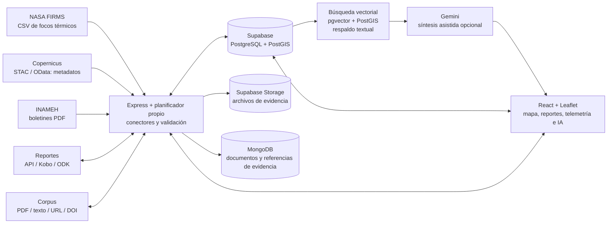

# Universidad Nacional Experimental de Guayana

**Maestría en Tecnologías de la Información** 
**Arquitecturas de Datos Inteligentes**

## Proyecto Integrador

# Centinela Orinoco

### Arquitectura de datos inteligentes para la detección temprana y el monitoreo de la minería ilegal en el Arco Minero del Orinoco

**Informe técnico del prototipo** 
**Sede:** Puerto Ordaz 
**Cohorte:** IX 
**Período:** Trimestre III, 2026 
**Asignatura:** Seminario I: Arquitectura de Datos Inteligentes 
**Profesora:** PhD. Livia Carolina Borjas Medina

**Integrantes:**

- Julio Cesar Canelón Rangel
- José Francisco Escalante Rosales
- Miguel Damián Mota Garrido

**Fecha:** octubre de 2026 
**Fecha de evaluación tecnológica:** 25 de octubre de 2026

---

## Resumen ejecutivo

Centinela Orinoco es una arquitectura de datos inteligente en fase de prototipo que integra información geoespacial, registros ambientales, reportes comunitarios y análisis asistido por inteligencia artificial. Una interfaz cartográfica articula servicios de ingesta para NASA FIRMS, catálogos Copernicus STAC/OData y boletines hidrológicos del INAMEH. La persistencia combina Supabase (PostgreSQL/PostGIS) y MongoDB para registros y evidencias de incidentes.

La evaluación evidencia avances en la consulta automatizada de fuentes externas. No obstante, Sentinel-1, Sentinel-2 y Sentinel-3 se incorporan como metadatos de catálogo, no como imágenes procesadas; el INAMEH aporta niveles de boletines, no telemetría directa ni mediciones de calidad del agua. La recuperación aumentada por generación (RAG) usa vectores semánticos (embeddings de Gemini en pgvector) combinados con un filtro geográfico, y recurre a la búsqueda textual si el modelo no está disponible; su umbral se fijó con un criterio de precisión y se propone calibrarlo con consultas etiquetadas. Gemini puede sintetizar las evidencias, pero no valida alertas ni ejecuta acciones en terreno.

La solución integra fuentes heterogéneas y contempla persistencia híbrida de denuncias e incidentes, con control de idempotencia para reportes confirmados. Permanecen pendientes un Lakehouse, un orquestador como Apache Airflow, almacenamiento edge durable, protocolos MQTT/LoRaWAN, control de acceso integral por roles y despliegue con Docker/Kubernetes. Las cinco referencias académicas suministradas carecen de datos suficientes para verificar su indexación, mientras los lineamientos exigen diez artículos. Por tanto, la plataforma requiere validaciones de datos, seguridad, desempeño y pertinencia social antes de su utilización en campo.

---

## Delimitación metodológica

El análisis contrasta los lineamientos académicos con las capacidades observables del prototipo y la documentación técnica disponible. Para evitar atribuciones no sustentadas, se diferencian las funciones incorporadas al diseño, aquellas cuyo funcionamiento depende de credenciales y servicios externos, y los componentes que permanecen como trabajo futuro. La disponibilidad de una integración se considera condicionada a su configuración y operación efectiva.

La evaluación corresponde al estado de la solución al 25 de octubre de 2026. No se ejecutaron pruebas con credenciales de NASA FIRMS, MongoDB o INAMEH, ni se verificó el estado del despliegue público. La memoria semántica vectorial sí se verificó contra Supabase y Gemini (sección 3.3). La cobertura y actualidad de los datos dependen de la disponibilidad, los límites y las condiciones de acceso de cada fuente. Los datos cartográficos estáticos, los contenidos demostrativos y los registros históricos deben distinguirse de las observaciones obtenidas mediante ingesta externa.

# Capítulo I. Diagnóstico territorial y planteamiento del problema

## 1.1 Contextualización

El proyecto aborda la detección temprana y el monitoreo de actividades mineras no reguladas y de sus posibles efectos ambientales en la cuenca del Orinoco, con énfasis en los estados Amazonas, Bolívar y Delta Amacuro. El problema se relaciona con la pérdida de cobertura vegetal, la alteración de ríos y sedimentos, la posible contaminación por metales y la exposición de comunidades y áreas protegidas.

La problemática tecnológica se vincula con la dispersión de fuentes que presentan formatos, escalas espaciales y frecuencias de actualización heterogéneas, entre ellas productos satelitales, boletines hidrológicos, documentos científicos y reportes comunitarios. En territorios remotos, la conectividad intermitente y la sensibilidad de la información comunitaria requieren mecanismos de resiliencia, trazabilidad, privacidad y revisión humana. La integración de estas fuentes puede facilitar su consulta contextual; sin embargo, no sustituye la observación de campo ni constituye evidencia suficiente de la ocurrencia de minería ilegal.

## 1.2 Problema específico

La fragmentación de los sistemas de información dificulta contextualizar una anomalía remota junto con registros hidrológicos, reportes locales y antecedentes científicos. La ausencia de trazabilidad, control de calidad y criterios de corroboración puede conducir a interpretaciones parciales o a atribuir una señal a una causa distinta de la que la originó.

Centinela Orinoco incorpora conectores para algunas fuentes y una interfaz común de consulta. La cobertura de la ingesta es parcial: se consultan focos térmicos y catálogos de productos satelitales, pero no se descargan ni procesan imágenes para detectar cambios de cobertura. Los niveles de los ríos se obtienen de boletines publicados por el INAMEH, sin conexión directa a sensores. En consecuencia, el prototipo no acredita una capacidad operacional para detectar minería ni permite inferir la calidad del agua a partir de los datos actualmente disponibles.

## 1.3 Datos considerados y situación comprobada

| Fuente | Datos previstos en la propuesta | Alcance actual de la integración |
| --- | --- | --- |
| NASA FIRMS | Coordenadas, fecha, temperatura de brillo, confianza y potencia radiativa | Se consultan productos VIIRS/MODIS, se normalizan los registros y se filtran según el ámbito territorial establecido. La ventana de consulta es de dos días; la operación depende de credenciales y conectividad. |
| Copernicus Sentinel-1 SAR | Firmas radar, coherencia y área afectada | Se consultan catálogos STAC y se almacenan metadatos de escenas GRD y su cobertura. No se descargan rásteres ni se calculan retrodispersión, coherencia o perturbaciones. El análisis SAR de nivel 2 permanece pendiente. |
| Copernicus Sentinel-2 MSI | Productos, nubosidad, bandas y anomalías ópticas | Se consultan productos L2A y se almacenan metadatos de cobertura, fecha y nubosidad. No se descargan ni analizan bandas espectrales. |
| Copernicus Sentinel-3 OLCI/SLSTR | Productos de observación para agua y superficie | Se consultan catálogos OData y se almacenan metadatos del producto, tipo, fechas, tamaño y cobertura. No se descargan ni procesan los productos científicos. |
| INAMEH | Nivel, variación y alertas hidrológicas | Se procesan boletines PDF de cuatro estaciones para extraer niveles y fechas y calcular variación, tendencia, margen a la cota y estado de alerta cuando existe referencia. No hay sensores físicos conectados. Esta integración no dispone de valores de pH, turbidez, conductividad ni mercurio. |
| Comunidades, Kobo y ODK | Denuncias georreferenciadas, narrativas y evidencias | Se contempla la recepción de denuncias y formularios mediante servicios web. La persistencia requiere Supabase y los archivos se almacenan en Supabase Storage. La disponibilidad de estas vías depende de la configuración y conexión efectiva con los sistemas externos. |
| Corpus científico | PDF, texto, URL/DOI y metadatos de estudios | Se admite el procesamiento de documentos y la consulta de metadatos DOI/Crossref con asistencia de Gemini. Los metadatos y la clasificación automatizada no acreditan indexación académica, arbitraje ni exactitud de los sitios identificados. |

La versión evaluada contempla estructuras de persistencia para los registros satelitales e hidrológicos y una bitácora de las ejecuciones de ingesta. La disponibilidad de estas estructuras en un entorno operativo depende de su configuración y despliegue.

## 1.4 Objetivo del proyecto

Diseñar y prototipar una arquitectura de datos inteligente que apoye la integración y el análisis contextual de señales ambientales y reportes comunitarios relacionados con la minería ilegal en el Arco Minero del Orinoco.

### Objetivos específicos

1. Integrar en una interfaz geoespacial capas de alertas, estaciones, áreas protegidas, incidentes y denuncias.
2. Implementar conectores para fuentes satelitales, boletines hidrológicos y documentos científicos, con persistencia de registros y procedencia.
3. Implementar persistencia híbrida para denuncias, incidentes y evidencias asociadas.
4. Explorar el análisis asistido por modelos Gemini y la síntesis contextual para apoyar la revisión humana.
5. Identificar las brechas técnicas, científicas y de gobernanza necesarias para evolucionar a una solución validable en campo.

## 1.5 Justificación y aporte

La propuesta se articula conceptualmente con AmazonIA 4.0 al combinar datos territoriales, herramientas de inteligencia artificial y una interfaz de apoyo a decisiones ambientales. El aporte de la solución consiste en integrar fuentes heterogéneas en una vista geoespacial y establecer un flujo controlado para promover una denuncia confirmada a incidente. Este proceso contempla claves de idempotencia, operaciones transaccionales en PostgreSQL y persistencia documental en MongoDB.

El proyecto no presenta una técnica novedosa de teledetección ni un modelo predictivo entrenado y validado. Su contribución se circunscribe a la articulación de una arquitectura inicial para el contexto territorial y a la automatización de un conjunto acotado de procesos de ingesta. La utilidad ambiental, la precisión de las alertas y la aceptación comunitaria requieren evaluación mediante datos y protocolos verificables.

# Capítulo II. Estado del arte y marco científico

## 2.1 Líneas de investigación pertinentes

La propuesta identifica cinco áreas pertinentes para fundamentar la solución: inteligencia artificial aplicada al monitoreo ecosistémico; tecnologías inteligentes y resiliencia climática; sistemas de soporte de decisiones para la sostenibilidad; analítica de Big Data; y gemelos digitales con sincronización de datos de campo. Las referencias proporcionadas se presentan como títulos y plataformas, pero no incluyen autores ni metadatos suficientes para confirmar su publicación, arbitraje e indexación o para completar citas APA.

| Referencia declarada en la propuesta | Año y plataforma declarados | Relación con el proyecto | Verificación pendiente |
| --- | --- | --- | --- |
| “The Impact of Artificial Intelligence on the Sustainability of Regional Ecosystems” | 2025, MDPI | IA aplicada al monitoreo de ecosistemas | Autores, revista, volumen, páginas y DOI; comprobar existencia, indexación y contenido. |
| “Are smart technologies enough to build climate-resilient cities and regions?” | 2026, ScienceDirect | Gobernanza, Big Data, IoT e IA para resiliencia | ScienceDirect es una plataforma; identificar revista, autores y DOI. |
| “Applications of AI to low carbon decision support systems in global networks” | 2025, ScienceDirect | Analítica y soporte de decisiones de sostenibilidad | Identificar autores, revista, DOI, método y relación directa con el caso. |
| “Big Data Analytics in Information Systems Research: Current Landscape and Future Prospects” | 2025, ResearchGate | Diseño de analítica y características de Big Data | Confirmar publicación original, autores, revista y DOI; ResearchGate no acredita indexación. |
| “Digital twins for regional and supply chain systems: Literature review and conceptual frameworks” | 2024, ResearchGate | Sincronización de observaciones de campo y modelos | Confirmar publicación original, autores, revista y DOI; ResearchGate no acredita indexación. |

## 2.2 Brecha metodológica y contribución

La brecha que plantea el proyecto es la falta de una vista integrada para consultar anomalías ambientales junto con reportes comunitarios, registros hidrológicos y documentos científicos. La solución busca relacionar fuentes geoespaciales y narrativas, y ofrecer síntesis mediante un modelo de lenguaje.

La integración actual es parcial. Cada documento de `environmental_rag_documents` se vectoriza con el modelo `gemini-embedding-001` (768 dimensiones) y se guarda en pgvector. La búsqueda RAG combina en una sola consulta la similitud coseno y, cuando se indica una ubicación, un radio geográfico con PostGIS; luego reordena los resultados con un puntaje que pondera similitud, proximidad, recencia, arbitraje y severidad, y Gemini resume únicamente las evidencias recuperadas. Si no es posible vectorizar la consulta, se recurre a la coincidencia de términos y la distancia. El umbral de similitud y los pesos del reordenamiento son valores de diseño, y su calibración con consultas etiquetadas se propone en la sección 3.3; una búsqueda sin coincidencias no produce evidencia para recomendar una acción.

## 2.3 Revisión crítica de requisitos científicos

La plantilla de propuesta menciona inicialmente cinco artículos, pero sus directrices científicas y la estructura del informe técnico final exigen analizar como mínimo diez fuentes indexadas. Se adopta el requisito más exigente de diez artículos de Scopus, Web of Science, SciELO o índice equivalente. Las cinco entradas aportadas no permiten verificar actualmente ni la autoría ni la indexación, y no satisfacen por sí mismas ese requisito.

Antes de la entrega académica definitiva deben incorporarse al menos diez trabajos comprobables, analizarse críticamente y citarse en formato APA. Para cada fuente se requiere título, autoría, año, revista, DOI o URL editorial, método, datos, hallazgos y limitaciones pertinentes. La búsqueda bibliográfica debe incluir estudios sobre minería y degradación en la Amazonía, teledetección, monitoreo hidrológico, arquitecturas de datos, RAG y resiliencia de sistemas distribuidos. Las afirmaciones atribuidas a UNESCO, Scopus, Web of Science o publicaciones académicas requieren fuentes verificables.

# Capítulo III. Diseño de la arquitectura de datos inteligente

## 3.1 Arquitectura implementada y demostrada

El diagrama sintetiza los componentes funcionales considerados en la arquitectura y sus relaciones. La operación de los servicios externos está sujeta a la disponibilidad de credenciales y conectividad. Los registros de catálogo no corresponden a imágenes satelitales procesadas, y las capas cartográficas de referencia deben distinguirse de las observaciones incorporadas mediante ingesta. En la gestión de evidencias, Supabase Storage almacena los archivos, mientras MongoDB conserva documentos con referencias y metadatos asociados.

## 3.2 Capas y estado técnico

| Capa | Alcance funcional actual | Requerimiento pendiente |
| --- | --- | --- |
| Ingesta | Servicios web y un planificador automatizado consultan NASA FIRMS, catálogos Copernicus e INAMEH; se consideran también reportes comunitarios y documentos. | Incorporar sensores IoT y, según la escala requerida, tecnologías como Kafka o NiFi. El funcionamiento de las fuentes existentes depende de credenciales, conectividad y disponibilidad externa. |
| Persistencia | Supabase integra PostgreSQL/PostGIS para información relacional y espacial; Supabase Storage conserva evidencias y MongoDB almacena documentos asociados a incidentes. | Diseñar una arquitectura Lakehouse con zonas de datos crudos, validados y analíticos. La persistencia poliglota actual se limita a procesos específicos y no constituye una plataforma analítica distribuida. |
| Procesamiento | Se normalizan focos FIRMS, se catalogan productos satelitales, se extraen boletines del INAMEH, se controlan duplicados y se calculan indicadores hidrológicos. | Incorporar procesamiento distribuido y análisis de píxeles satelitales. No se dispone de un modelo de aprendizaje automático entrenado y validado para detectar minería. |
| Memoria semántica | Los documentos se vectorizan con Gemini (768 dimensiones) y se recuperan por similitud coseno en pgvector con filtro geográfico PostGIS y reordenamiento compuesto; si el modelo no responde, se usa la búsqueda textual. Gemini puede sintetizar los resultados. | Calibrar el umbral de similitud y los pesos con consultas y documentos etiquetados; la cuota gratuita de Gemini limita la vectorización a 1.000 textos por día. |
| Orquestación | Las tareas de ingesta operan con cadencias predefinidas y pueden activarse mediante un servicio de cron externo protegido. | Incorporar Apache Airflow o una alternativa que permita gestionar dependencias, reintentos, observabilidad y recuperación ante fallos. |
| Consumo | Una aplicación web cartográfica integra módulos de denuncias, telemetría, corpus, ingesta y asistencia de inteligencia artificial. | Validar la utilidad con los usuarios previstos y evitar decisiones ambientales automatizadas sin evaluación independiente. |
| Gobernanza | Se aplican controles de acceso a nivel de fila en la base de datos y se protege la información identificativa cuando una denuncia se declara anónima. | Definir control de acceso por roles, consentimiento, retención, anonimización espacial y protocolos de gobernanza biocultural. Algunas tablas de observación contemplan lectura pública. |
| Resiliencia | Se dispone de almacenamiento local limitado en la interfaz y de persistencia remota cuando los servicios externos están disponibles. | Implementar almacenamiento edge durable, sincronización diferida, cifrado local y protocolos livianos como MQTT/LoRaWAN cuando el entorno lo justifique. |
| Calidad | Se aplican validaciones de entrada, restricciones de integridad y deduplicación de registros. Hay 26 pruebas unitarias automatizadas (`npm test`) para la memoria semántica: embeddings, reordenamiento, respaldo textual y vectorización por lotes. | Extender las pruebas a la ingesta, la saga de incidentes y las entradas vacías o corruptas, y agregar pruebas de integración para desconexiones, reintentos y recuperación. |
| Despliegue | Se contempla ejecución local y publicación en una plataforma de alojamiento web. | Especificar contenedorización, gestión de secretos, observabilidad, respaldos y recuperación. No se documenta una arquitectura de alta disponibilidad basada en Docker/Kubernetes. |

## 3.3 Ingesta, búsqueda y soporte a decisiones

El planificador define tareas periódicas para FIRMS, Sentinel-1, Sentinel-2, Sentinel-3 e hidrología. Las respuestas externas se transforman al modelo de datos de la plataforma, se normalizan conforme a las reglas de cada fuente y se someten a controles de duplicidad. Cada ejecución puede registrar su inicio y finalización, estado, cantidad de registros y fuente consultada. También se contempla la activación de tareas vencidas mediante un servicio de cron externo protegido. La continuidad de este proceso depende de la configuración de credenciales y servicios de ejecución.

La ingesta de FIRMS requiere `FIRMS_MAP_KEY`; la descarga de Sentinel usa servicios Copernicus y la hidrología depende de páginas y documentos PDF publicados por INAMEH. Las fallas de una fuente, respuestas parciales, límites de páginas y boletines desactualizados pueden afectar la cobertura. Por tanto, la existencia del conector no garantiza continuidad ni actualidad de los datos.

El mecanismo de recuperación documental vectoriza la consulta con Gemini y busca en pgvector los documentos con mayor similitud coseno, por encima de un umbral de 0,65; cuando se proporciona una ubicación, limita la búsqueda a un radio con PostGIS en la misma consulta SQL. Los candidatos se reordenan con un puntaje que pondera similitud (0,45), proximidad (0,20), recencia (0,15), arbitraje (0,10) y severidad (0,10). Si la consulta no puede vectorizarse o ningún documento supera el umbral, se recurre a la coincidencia de términos y la distancia geográfica. Gemini puede elaborar una síntesis de los documentos recuperados; ante la indisponibilidad del modelo, se presentan los documentos sin dicha síntesis. La interfaz informa el método empleado (vectorial o textual de respaldo), la similitud de cada resultado y el motivo cuando se usa el respaldo.

Los documentos se insertan sin vector y un proceso del servidor los vectoriza por lotes al arrancar, tras cada ingesta y al ingresar un documento al corpus, de modo que un fallo o una cuota agotada en Gemini no detiene la ingesta. La migración se aplicó en producción el 25 de octubre de 2026 y los 1.216 documentos de la memoria semántica quedaron vectorizados. El proceso respeta la cuota gratuita de Gemini (1.000 textos por día) y, si se agota, se pausa y retoma solo al renovarse. En una prueba con documentos reales, la consulta "contaminación por mercurio de la minería" recuperó los artículos del corpus sobre mercurio (similitud de 0,72 a 0,74) y "crecida del Orinoco" recuperó las lecturas del INAMEH (0,69) sin que esos documentos contengan la palabra "crecida". La consulta "incendios o actividad térmica cerca del río Atabapo" no superó el umbral con los cuatro documentos de esa zona y se resolvió con la búsqueda textual, lo que muestra en operación el mecanismo de respaldo.

El umbral de 0,65 se fijó con un criterio de precisión: en un sistema que orienta intervenciones en el territorio, un documento recuperado que no es pertinente resulta más costoso que uno omitido, y las consultas que no alcanzan el umbral quedan cubiertas por la búsqueda textual. El valor se ubicó por debajo de las similitudes que obtuvieron los documentos pertinentes en las pruebas (0,69 a 0,74). Para ajustarlo a cada tipo de consulta se propone una calibración con consultas etiquetadas: especialistas marcan qué documentos son pertinentes para cada consulta de prueba, se evalúan varios umbrales (por ejemplo, de 0,50 a 0,70) y se elige el que equilibre los documentos pertinentes recuperados con los resultados no pertinentes; el mismo procedimiento permite ajustar los pesos del reordenamiento.

La analítica por zona combina registros almacenados y reglas deterministas con síntesis de modelos Gemini cuando estos están configurados. Algunas clasificaciones territoriales se basan en listas de palabras clave para sectores y áreas protegidas, no en un modelo validado ni en una comprobación legal/geoespacial exhaustiva. Un foco térmico no confirma minería, y el catálogo de una escena Sentinel no acredita una perturbación. La elevación de una denuncia a incidente requiere estado confirmado en terreno y acción explícita; usa idempotencia y una saga PostgreSQL-MongoDB con compensación ante fallos.

**Criterio de seguridad operativa:** las coincidencias, clasificaciones y salidas de Gemini son apoyo no verificado. Ninguna alerta debe utilizarse para atribuir una actividad ilícita o intervenir en un territorio sin corroboración independiente, revisión humana y protocolo institucional.

## 3.4 Diseño objetivo recomendado

Para responder integralmente a la asignación, la evolución debe priorizar lo siguiente:

1. **Datos y procedencia:** verificar en ejecución cada fuente, guardar URL/identificador, hora de adquisición, licencia, versión, estado de calidad y transformaciones; separar explícitamente observaciones reales, capas base y contenidos de demostración.
2. **Procesamiento satelital:** descargar y procesar productos Sentinel en un flujo reproducible; definir algoritmos, ventanas temporales y validación contra referencia de campo antes de reportar perturbaciones SAR u ópticas.
3. **Lakehouse y orquestación:** diseñar zonas crudas, validadas y analíticas con MinIO/Delta Lake u opciones compatibles, y desplegar Airflow o equivalente. Kafka/NiFi deben seleccionarse solo si el volumen y la operación en tiempo real lo justifican.
4. **RAG verificable:** los embeddings (`gemini-embedding-001`, 768 dimensiones), su persistencia en pgvector y la búsqueda híbrida espacial/vectorial ya están implementados; falta evaluar recuperación y síntesis con consultas y documentos etiquetados, calibrar el umbral y los pesos, y prever una cuota de embeddings mayor que la gratuita si crece el volumen.
5. **Offline-first:** implementar almacenamiento local durable, cola de sincronización, reintentos, identificadores idempotentes y manejo de conflictos; evaluar MQTT/LoRaWAN para dispositivos y cobertura concretos.
6. **Gobernanza:** definir RBAC, privilegio mínimo, consentimiento, retención, anonimización y generalización espacial; acordar con las comunidades protección de datos y propiedad intelectual biocultural.
7. **Calidad y seguridad:** ampliar las pruebas unitarias existentes (hoy limitadas a la memoria semántica) y añadir pruebas de integración para datos vacíos/corruptos, duplicados, indisponibilidad, reintentos, compensación de saga, privacidad y fallos de IA. Medir precisión, falsos positivos, latencia y disponibilidad antes de cualquier piloto.
8. **Despliegue:** documentar contenedores, gestión de secretos, salud, observabilidad, copias de seguridad, límites de recursos y recuperación. Evaluar nube, edge o arquitectura híbrida según conectividad y presupuesto.

## 3.5 Usuarios y resultado esperado

La interfaz puede servir como herramienta de consulta para analistas ambientales, investigadores, responsables de monitoreo y equipos que reciben o verifican reportes. El mapa y los módulos permiten relacionar puntos térmicos, productos de catálogo, niveles hidrológicos, denuncias y documentos. Los beneficios esperados son reducir el cambio entre herramientas y dar contexto inicial a la revisión de evidencias.

No se ha documentado una evaluación de usabilidad con guardaparques, comunidades, científicos o instituciones; tampoco un piloto de campo. Los beneficios descritos son objetivos del diseño y no resultados medidos. El acceso de usuarios externos, la autorización por roles y la seguridad de reportes comunitarios deben definirse antes de ampliar su uso.

## 3.6 Despliegue y operación

La solución se ejecuta mediante servicios web y contempla su publicación en una plataforma de alojamiento que requiere configurar de forma segura las credenciales de Supabase, MongoDB y Gemini. La arquitectura actual no especifica contenedorización ni un esquema de alta disponibilidad. El plan de despliegue deberá incluir empaquetado de los componentes, administración segura de credenciales, comprobaciones de salud, observabilidad, copias de seguridad, políticas de actualización y procedimientos de recuperación. En áreas con conectividad intermitente, el nodo de campo deberá conservar los datos de forma cifrada y sincronizarlos cuando se restablezca el enlace. La selección de infraestructura deberá responder a las condiciones de energía, cobertura y operación del sur de Venezuela.

# Capítulo IV. Conclusiones, recomendaciones y proyección técnica

## 4.1 Conclusiones

1. Centinela Orinoco integra conectores para consultar fuentes externas como NASA FIRMS, los catálogos Copernicus y los boletines PDF de INAMEH. Esta capacidad está condicionada por la disponibilidad de credenciales, conectividad y servicios externos, por lo que no acredita por sí sola la operación continua de la plataforma.
2. La ingesta de Sentinel-1/2/3 almacena metadatos de productos; no procesa las bandas para detectar cambios. La fuente hidrológica aporta niveles de boletines, no telemetría de sensores ni mediciones de química del agua.
3. La persistencia de denuncias e incidentes es el flujo más desarrollado: contempla estados, geometría, evidencia, privacidad básica, idempotencia y compensación entre PostgreSQL y MongoDB.
4. La búsqueda es vectorial y espacial: recupera por similitud de embeddings de Gemini en pgvector dentro de un radio geográfico, con respaldo textual. Su umbral responde a un criterio de precisión y se propone calibrarlo con consultas etiquetadas; Gemini puede sintetizar la evidencia, pero no sustituye verificación de datos ni revisión humana.
5. El prototipo cubre una parte de la arquitectura de consumo e ingesta, e incorpora una memoria semántica vectorial con pruebas unitarias, pero no satisface aún los requisitos de Lakehouse, procesamiento distribuido, offline-first durable, RBAC integral, pruebas de integración y despliegue en contenedores.
6. La bibliografía de la propuesta contiene cinco referencias incompletas y no acredita el mínimo de diez fuentes indexadas solicitado en las directrices científicas y el informe final.
7. La factibilidad a mediano plazo es razonable como sistema de apoyo a investigación si se completa la verificación bibliográfica, se acota la detección a productos y métricas observables, y se valida seguridad, calidad de datos y uso con actores locales.

## 4.2 Alcances y limitaciones de la evaluación

La evaluación permite caracterizar la integración de fuentes y los mecanismos de persistencia actualmente contemplados, pero no determina el rendimiento de la plataforma bajo cargas de producción. Tampoco se dispone de mediciones de precisión para la identificación de actividades mineras, de una evaluación independiente de las síntesis generadas por inteligencia artificial ni de resultados de pruebas de disponibilidad y recuperación ante fallos.

La ingesta de catálogos satelitales no equivale al procesamiento de imágenes ni a la detección de cambios sobre el terreno. De igual forma, los boletines hidrológicos no sustituyen las mediciones instrumentales ni permiten establecer parámetros de calidad del agua que no estén publicados. Estas limitaciones delimitan el alcance de las conclusiones y orientan el trabajo futuro.

## 4.3 Recomendaciones priorizadas

- **Prioridad 1:** configurar los esquemas de persistencia en un entorno controlado y probar cada conector con credenciales válidas; registrar cobertura, frescura, errores y procedencia, y separar capas de datos estáticos o de demostración.
- **Prioridad 2:** completar procesamiento de productos satelitales antes de presentar perturbaciones o alertas SAR/ópticas como mediciones; establecer validación de campo y métricas de falsos positivos.
- **Prioridad 3:** evaluar de forma reproducible el RAG vectorial ya implementado (consultas etiquetadas, calibración del umbral y de los pesos, versionado del modelo de embeddings); asegurar la correspondencia entre los resultados presentados en la interfaz y los cálculos del servicio de análisis.
- **Prioridad 4:** verificar y analizar diez o más artículos indexados, con metadatos editoriales y citas APA comprobables; no usar las cinco referencias actuales como bibliografía validada.
- **Prioridad 5:** ampliar las pruebas automatizadas a la ingesta y la saga, implementar RBAC, consentimiento y protección de coordenadas/datos comunitarios; realizar una revisión de seguridad y privacidad antes de un piloto.
- **Prioridad 6:** diseñar una estrategia durable offline-first, almacenamiento analítico tipo Lakehouse y despliegue reproducible; añadir Airflow, Docker/Kubernetes u opciones equivalentes según requisitos y recursos.

## 4.4 Matriz de cumplimiento de la propuesta

| Requisito | Nivel de correspondencia | Acción requerida |
| --- | --- | --- |
| Portada y resumen ejecutivo | Incluidos; resumen dentro del límite de 250 palabras | Completar datos administrativos institucionales que se soliciten. |
| Diagnóstico amazónico y justificación AmazonIA 4.0 | Incluidos para el Orinoco y el Arco Minero | Incorporar indicadores territoriales y afirmaciones respaldadas con bibliografía verificable. |
| Antecedentes indexados | No satisfecho: cinco referencias incompletas en la propuesta, frente al mínimo de diez de las directrices | Verificar y analizar al menos diez artículos indexados con citas APA. |
| Arquitectura formal y especificación por capas | Se incluye diagrama funcional y estado de las capas | Adaptar a C4 si se exige; agregar Lakehouse y flujos objetivo claramente diferenciados de lo implementado. |
| Ingesta dinámica | FIRMS, catálogos Copernicus e INAMEH tienen conectores de servidor; se registra ejecución | Probar en entorno configurado; añadir sensores o fuente de campo según alcance; documentar calidad y continuidad. |
| Procesamiento e inteligencia | Transformaciones deterministas y análisis asistido por Gemini | Procesar imágenes y validar modelos/reglas antes de afirmar detección predictiva. |
| RAG y base vectorial | Embeddings de Gemini en pgvector, búsqueda vectorial con filtro geográfico PostGIS, reordenamiento compuesto y respaldo textual | Calibrar umbral y pesos con consultas etiquetadas; evaluar la calidad de recuperación y síntesis. |
| Offline-first, MQTT/LoRaWAN y Edge | No implementado de forma durable | Diseñar almacenamiento local persistente y protocolo de sincronización acorde al hardware. |
| Gobernanza y privacidad | RLS y anonimato básico en persistencia de denuncias | Añadir RBAC, consentimiento, retención, anonimización espacial y acuerdos de gobernanza. |
| Pruebas de tolerancia a fallos | 26 pruebas unitarias automatizadas para la memoria semántica, incluidos fallos de Gemini, cuota agotada y errores de Supabase | Extender a la ingesta y la saga; agregar pruebas de integración para entradas corruptas o vacías, desconexión y reintentos. |
| Plan de despliegue Docker/Kubernetes | Se contempla publicación web, pero no se especifica una arquitectura de contenedores | Definir contenedorización, gestión de credenciales, observabilidad, respaldo y recuperación. |
| Resultado para usuarios finales | Se dispone de una interfaz funcional; no se presentan resultados de evaluación con usuarios | Validar con investigadores, equipos de campo y comunidades bajo un protocolo ético. |

## 4.5 Consideraciones de validez

Las conclusiones se circunscriben a las capacidades descritas para el prototipo y a la documentación técnica disponible en la fecha de evaluación. La ausencia de pruebas de campo, métricas de desempeño y evaluación con usuarios limita la generalización de los resultados. Por tanto, las funciones de consulta y análisis deben interpretarse como apoyo a la investigación y no como evidencia concluyente ni como sustituto de la verificación institucional.

## Referencias bibliográficas

### Referencias científicas declaradas en la propuesta, pendientes de validación

Las siguientes entradas reproducen los datos disponibles en la propuesta. No constituyen referencias APA completas ni acreditan por sí mismas existencia, arbitraje o indexación; deben comprobarse y completarse antes de la entrega definitiva.

1. *The Impact of Artificial Intelligence on the Sustainability of Regional Ecosystems*. (2025). MDPI. Autores, revista específica, volumen, páginas y DOI no indicados en la propuesta.
2. *Are smart technologies enough to build climate-resilient cities and regions?* (2026). ScienceDirect. Autores, revista específica, volumen, páginas y DOI no indicados en la propuesta.
3. *Applications of AI to low carbon decision support systems in global networks*. (2025). ScienceDirect. Autores, revista específica, volumen, páginas y DOI no indicados en la propuesta.
4. *Big Data Analytics in Information Systems Research: Current Landscape and Future Prospects*. (2025). ResearchGate. Publicación original, autores y DOI no indicados; ResearchGate no acredita indexación.
5. *Digital twins for regional and supply chain systems: Literature review and conceptual frameworks*. (2024). ResearchGate. Publicación original, autores y DOI no indicados; ResearchGate no acredita indexación.

### Documento institucional de referencia

- Universidad Nacional Experimental de Guayana. (2026). *Propuesta del Proyecto Integrador: Aplicaciones de Arquitectura de Datos Inteligente para la Amazonía* [Documento de asignación académica].